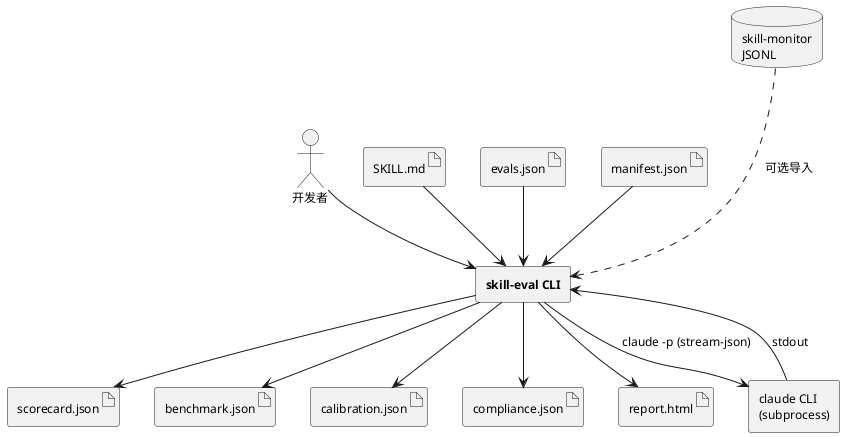
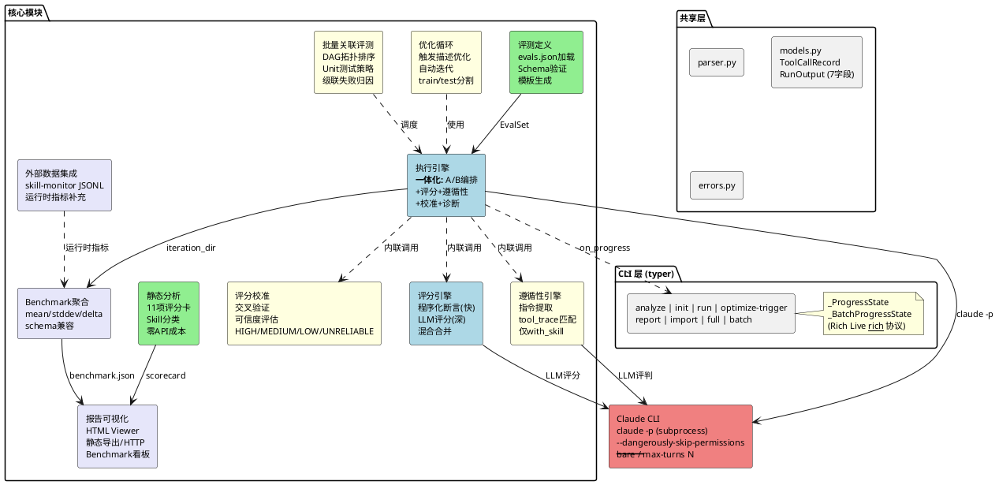
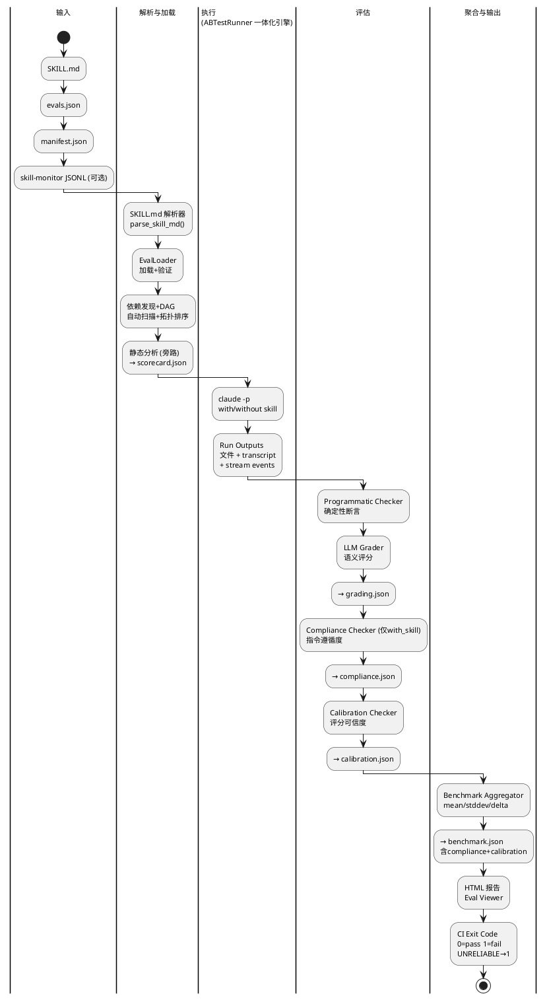
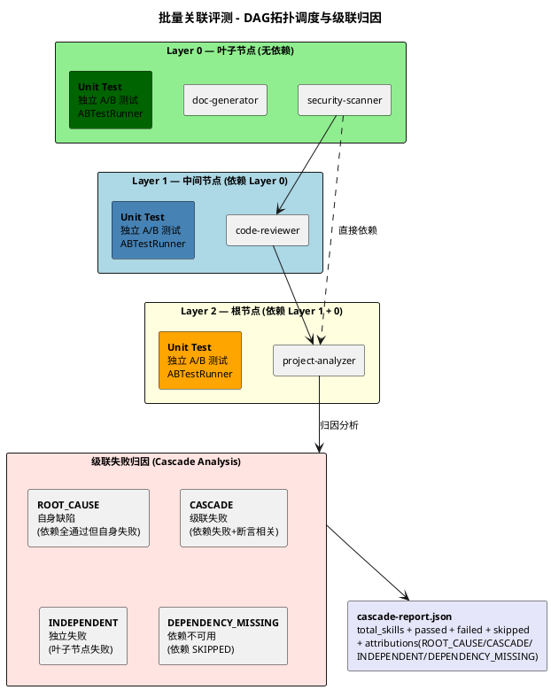

# Skill-Eval 架构设计文档

> 本文档面向架构师和技术决策者。聚焦"为什么这样设计"和"模块间契约"。
> 实现级细节（Pydantic 模型定义、函数签名、参数表、伪代码）参见 `skill-eval-design.md`。

---

## 1. 系统定位

**skill-eval** 是一个独立 Python CLI 工具，对 Claude Code 的 Skill（以 `SKILL.md` 为核心的技能定义文件）进行自动化评测。将 Skill 开发从基于直觉的"艺术"转变为可度量、可迭代、可回归验证的"工程实践"。

**系统边界**：

| 边界 | 内容 |
|------|------|
| **输入** | 一个或多个 `SKILL.md` 所在目录 + 可选的 `evals.json` 评测定义 |
| **输出** | `benchmark.json` + `grading.json` + `compliance.json` + `run_debug.json` + HTML 报告 + CLI exit code |
| **外部依赖** | 本地安装的 `claude` CLI（通过 subprocess 调用 `claude -p`） |
| **不依赖** | Claude Code 运行时、OpenCode 运行时、任何第三方 API Key |

### 系统上下文



---

## 2. 设计约束与关键决策

### 2.1 约束

| 编号 | 约束 | 理由 |
|------|------|------|
| C1 | 第一版仅支持 `claude -p` CLI 子进程调用 | 收窄范围；复用 claude CLI 认证，无需管理 API Key |
| C2 | 所有 JSON 输出格式与 `skill-creator` 保持 schema 兼容 | 共享 viewer.html 等工具链 |
| C3 | 独立 CLI，不依赖 Claude Code subagent 运行时 | 无内部耦合，可独立发布 |
| C4 | 静态分析零 API 成本；动态评测需 claude CLI + API 额度 | 用户无需 API 也能获得即时价值 |
| C5 | 混合评分：程序化断言 + LLM 评分，可独立开关 | 灵活权衡成本与覆盖度 |
| C6 | Python 3.10+，typer CLI，pydantic 数据模型 | 与 skill-creator 脚本生态一致 |
| C7 | 所有命令支持 `--format json` + exit code | CI 就绪 |
| C8 | 全局 UTF-8 编码 | 跨平台一致性 |
| C9 | 路径约定：相对路径基于 cwd，manifest path 基于 manifest 文件 | 可预测的路径解析 |

### 2.2 关键架构决策

**决策 1：所有 LLM 交互通过 `claude -p` subprocess**

不使用 REST API、不使用 SDK。唯一与 Claude 的交互方式是 `subprocess.Popen(["claude", "-p", ...])` + `communicate(timeout=N)` + `proc.kill()`。
理由：零额外依赖，复用用户已有的 claude CLI 认证，避免 API Key 管理。`subprocess.run(timeout=N)` 对 claude 子进程超时不可靠，已全部替换为 Popen 方案。

**决策 2：执行引擎是一体化引擎**

`ABTestRunner` 是一体化引擎：执行 → 评分 → 遵循性检查 → 评分校准 → 诊断输出，全部在 `run_ab_test()` 内部完成。CLI 层只需调用一次即可获得完整结果。
理由：评分和遵循性检查依赖执行产出的 `RunOutput`（transcript、tool_trace 等），将它们内联到执行流程中避免了中间状态管理复杂度。

**决策 3：三层质量保障——评分 + 遵循性 + 校准**

评分引擎（Scoring）检查**输出是否正确**，遵循性引擎（Compliance）检查**过程是否合规**，评分校准（Calibration）检查**评分本身是否可信**。三者由 ABTestRunner 统一编排，内联调用，结果汇入同一个 benchmark。
理由：单一评分无法区分"输出正确但过程错误"和"评分漏判了关键问题"。

**决策 4：Schema 兼容优先**

`grading.json` 和 `benchmark.json` 的字段名（`expectations`、`text`、`passed`、`evidence`、`with_skill`、`without_skill`）严格保持与 skill-creator 一致，因为 `viewer.html` 依赖这些字段名。
理由：工具链共享，避免 fork。

**决策 5：移植 + 改造 skill-creator 代码**

从 skill-creator 直接复制脚本到新项目并改造为独立 CLI，而非从零重写或作为库引用。
理由：skill-creator 是 Claude Code subagent 内的脚本，不是可 pip install 的库。直接复制最简单可控。

---

## 3. 评测维度与质量公式

系统围绕六个维度评估 Skill 质量：

```
Score = StaticCompliance(0-11)
      + DeltaPassRate(%)
      + InstructionCompliance(%)
      + TriggerAccuracy(%)
      - PerformancePenalty(TimeDelta × TokenDelta)
      × CalibrationGrade(HIGH=1.0, MEDIUM=0.8, LOW=0.5, UNRELIABLE=0.2)
```

| 维度 | 衡量什么 | 数据来源 |
|------|----------|----------|
| **执行保真度** | 输出是否符合预期 | grading.json → pass_rate |
| **指令遵循度** | 执行过程是否按 SKILL.md 指令操作 | compliance.json → compliance_rate |
| **量化改进** | Skill 加载后输出是否优于基线 | benchmark.json → delta |
| **评分可信度** | 评分结果本身是否可靠 | calibration.json → grade |
| **回归预防** | 模型/代码变更是否导致退化 | benchmark.json diff → regression delta |
| **触发精确性** | Skill 是否正确触发/不触发 | TriggerEvaluator → TP/FP rate |

注意 `CalibrationGrade` 是**乘法系数**：如果评分不可信（UNRELIABLE），整个分数会被大幅折扣。

### 成功标准

| 场景 | 标准 |
|------|------|
| 静态分析 | 对任意合法 SKILL.md 在 <1s 内输出 11 项评分 |
| A/B 评测 | 1 skill × 2 configs × N runs（默认 2 次 claude -p 调用）|
| 触发优化 | 5 轮迭代后触发精度 >90% |
| 回归检测 | benchmark.json diff 能自动识别"Skill 可退役" |
| CI 集成 | `--format json` 模式下 exit code 正确 |

---

## 4. 组件架构



各模块在核心流水线中从左到右串联：静态分析 → 评测定义 → 执行引擎 → 评分引擎 → 遵循性引擎 → 评分校准 → Benchmark 聚合。优化循环和批量评测作为上层编排器，使用执行和评分模块作为内部组件。

---

## 5. 模块契约

### 5.1 静态分析引擎 (`static_analysis/`)

| 属性 | 值 |
|------|------|
| **职责** | 对 SKILL.md 做零成本自动化体检（11 项检查 + Skill 分类） |
| **输入** | SKILL.md 所在目录路径 |
| **输出** | `scorecard.json`（11 项 pass/fail + 总分 + 分类） |
| **外部调用** | 无（纯本地文件分析，<1s 完成） |
| **关键契约** | 不调用任何 LLM；分类结果影响后续评测策略 |

**11 项检查**：description 长度/触发词/第三人称、name kebab-case/长度/无保留字、文件行数≤500、有示例、reference 目录扁平、有 anti-fabrication 规则、路径合规。

**分类**：`CAPABILITY_UPLIFT`（增强型）vs `ENCODED_PREFERENCE`（编码偏好型），通过检测 SKILL.md body 中的关键词信号（"exact template"/"team convention" 等）判定。分类结果影响评测策略——偏好型 Skill 侧重格式合规，增强型侧重语义质量。

### 5.2 评测定义层 (`evals/`)

| 属性 | 值 |
|------|------|
| **职责** | 加载、验证、可选生成评测用例 |
| **输入** | `evals.json` 路径 或 Skill 目录（生成模板） |
| **输出** | 内存中的 `EvalSet`；或磁盘上的 `evals.json` 模板 |
| **关键契约** | 每个 EvalCase 包含 prompt、expectations（语义预期）、assertions（程序化断言）、fixtures（前置文件）、level（测试层级）| 

**评测用例结构**：每个 EvalCase 包含一个用户任务 prompt、预期输出描述、可选输入文件列表、可验证的预期语句列表、程序化断言列表、测试前置文件（FixtureFile: path + content）、测试层级（L1 单元级 / L2 Mock 场景 / L3 全流程）。断言类型涵盖：文件存在、正则匹配、JSON 字段检查、行数统计、反向匹配、自定义脚本执行。

**验证规则**：skill_name 非空、evals 非空、id 唯一、prompt 非空、引用文件存在。

**L1 生成**：`skill-eval init` 默认使用 `--generate-prompts`，调用 `claude -p` 根据 SKILL.md 生成 L1 单元级测试（6 类：输入验证、决策逻辑、调度排序、Skill 绑定、错误处理、输出格式）。`--no-generate-prompts` 回退到按 `##` 标题的模板生成。

### 5.3 执行引擎 (`execution/`)

| 属性 | 值 |
|------|------|
| **职责** | A/B 测试编排 + 内联评分 + 遵循性检查 + 诊断输出 |
| **输入** | Skill 路径 + EvalSet + RunConfig（runs_per_config, model, timeout, max_workers, output_dir, **max_turns**）+ ScoringConfig + on_progress 回调 |
| **输出** | 结构化输出目录（with_skill/run-{n}/ 和 without_skill/run-{n}/ 含 grading.json + checkpoints.json + calibration.json + run_debug.json + compliance.json） |
| **外部调用** | `claude -p <prompt> --output-format stream-json --verbose --dangerously-skip-permissions --max-turns <N>`（subprocess.Popen + communicate(timeout) + proc.kill()） |
| **关键契约** | **一体化引擎 + 单次 AB 测试**。evals.json 中的 EvalCase 作为 checkpoint，整个 skill 只跑 2 次 `claude -p`（with/without），然后批量检查所有 checkpoint 覆盖率 |

**执行机制**：
- `with_skill` 模式：将 SKILL.md 内容临时写入 `.claude/commands/<name>-skill-<uuid>.md`，使 `claude -p` 能发现该 Skill。执行后清理临时文件。
- `without_skill` 模式：附加 `--bare` flag 调用 `claude -p`，跳过 skill/MCP 发现，加速启动。
- 串行执行（非并行），每 run 完成后立即评分 + 遵循性检查 + 评分校准 + 保存诊断。
- **错误恢复**：`ClaudeRunnerError` 在每次 run 内捕获，失败 run 写 `error.txt`，生成空 GradingResult（pass_rate=0），继续执行不中断。
- 环境隔离：移除 `CLAUDECODE` 环境变量，避免干扰。
- **`--dangerously-skip-permissions`**：所有 `claude -p` 调用统一加此 flag，跳过 workspace trust 确认和权限提示。
- **`--max-turns`**：限制 agentic 循环轮数（默认 10），防止无限 tool calls 导致超时。

**一体化流程（单次 AB + Checkpoint）**：
```
merged_prompt = _build_merged_prompt(eval_set)  # 合并所有 eval prompt

for config_name in ("with_skill", "without_skill"):
    for run_number in 1..runs_per_config:
        0. eval_case.setup_fixtures(outputs_dir)
        1. ClaudeRunner.run(merged_prompt, skill_path?, model, timeout, max_turns) → RunOutput
           catch ClaudeRunnerError → error.txt, grading=0, continue
        2. _score_checkpoints(eval_cases, transcript, outputs_dir)
               ONE batch claude -p for ALL checkpoint expectations
               → grading.json + checkpoints.json
        3. if with_skill:
               InstructionExtractor.extract(skill_body) → instructions
               ComplianceChecker.check(instructions, transcript, output_dir, ...)
                   → _check_llm_batch: ONE claude -p for all LLM_JUDGE (max 30, 90s)
                   → compliance.json + compliance.log
        4. CalibrationChecker.calibrate(grading, compliance_report?) → calibration.json
        5. save run_debug.json
        6. emit on_progress(phase, substep)
```

**RunOutput 新增字段**（vs 初始设计）：
- `tool_calls: dict[str, int]` — 每个工具名称调用次数
- `tool_trace: list[ToolCallRecord]` — 每次工具调用的 name + input_summary
- `result_text: str` — claude 最终文本输出
- `num_turns: int` — agentic 循环轮数
- `stop_reason: str` — 停止原因（"max_turns" | "end_turn" | ...）

**输出目录结构**：

```
<output_dir>/iteration-1/
  merged_prompt.txt
  with_skill/run-1/
    outputs/, timing.json, grading.json, checkpoints.json,
    compliance.json, compliance.log, calibration.json, run_debug.json
  without_skill/run-1/
    outputs/, timing.json, grading.json, checkpoints.json,
    calibration.json, run_debug.json, error.txt (if failed)
  benchmark.json
```

**stream-json 事件处理**：从 `claude -p` 的完整 stdout 中解析 stream-json 事件：`result` 事件获取 token 统计、耗时、result_text、num_turns、stop_reason；`assistant` 事件获取完整 transcript 文本；`content_block_start` 事件（type="tool_use"）提取 tool_calls 和 tool_trace。

### 5.4 评分引擎 (`scoring/`)

| 属性 | 值 |
|------|------|
| **职责** | 评估执行输出是否正确——检查**输出质量** |
| **输入** | Run 输出目录 + EvalCase（assertions + expectations）+ ScoringConfig（enable_programmatic, enable_llm, llm_model, llm_timeout） |
| **输出** | `grading.json`（expectations pass/fail + evidence + summary + claims + eval_feedback） |
| **外部调用** | LLM 模式下调用 `claude -p --output-format text`（subprocess.Popen + communicate + kill）。单次 AB 测试中使用 `_score_checkpoints` 批量调用 |
| **关键契约** | 三种模式（hybrid/programmatic/llm）。冲突时 LLM 优先。字段名必须与 viewer.html 兼容 |

**两条评分路径**：

| 路径 | 方式 | 特点 | 适用场景 |
|------|------|------|----------|
| **ProgrammaticChecker** | 程序化断言（文件存在、正则匹配、JSON 字段、行数、自定义脚本） | 确定性、快速、零 LLM 成本 | 输出结构化、可机械验证的场景 |
| **LLMGrader** | 调用 `claude -p` 执行语义评分 | 语义理解、深度分析、可发现隐含问题 | 输出需要语义判断的场景 |

**混合评分策略**（hybrid 模式）：
1. 先运行 ProgrammaticChecker 获得确定性结果
2. 再运行 LLMGrader 获得语义评分（同时将程序化结果作为输入供 LLM 参考）
3. 两个来源的 expectations 独立合并
4. 如果对同一 expectation 冲突（prog.pass != llm.pass），以 LLM 为准，source 标记为 "merged"
5. summary 从合并后的列表重新计算

**LLMGrader 的额外产出**：
- **claims**：从输出中提取并验证的隐含声明（factual/process/quality 三类）
- **eval_feedback**：对评测用例本身的改进建议（断言太弱、遗漏关键检查等）

**`_score_checkpoints` 批量评分**（ABTestRunner 内部方法）：

在单次 AB 测试模式下，所有 checkpoint 的 expectations 通过一次批量 `claude -p` 调用评估：
1. 收集所有 EvalCase 的 expectations，构建全局索引
2. 构建 batch prompt："You are a checkpoint evaluator. Determine which expectations are covered..."
3. 一次 `claude -p` 调用（通过 LLMGrader._call_claude），LLM 返回 JSON 数组
4. 按 index 对齐结果，拆分回各 checkpoint
5. 同时对有 assertions 的 checkpoint 运行 ProgrammaticChecker
6. 输出：`grading.json`（总体）+ `checkpoints.json`（per-checkpoint breakdown）

### 5.5 遵循性引擎 (`compliance/`)

| 属性 | 值 |
|------|------|
| **职责** | 验证执行**过程**是否遵循 SKILL.md 定义的工作流、工具使用要求和约束规则——检查**过程合规** |
| **输入** | instructions（预提取）+ 执行 transcript + tool_trace（RunOutput.tool_trace）+ 输出目录 + grading |
| **输出** | `compliance.json`（每条指令的 followed/evidence/confidence + 总体 compliance_rate） |
| **外部调用** | LLM_JUDGE 类指令通过**一次批量** `claude -p` 调用（subprocess.Popen + communicate(timeout=90s) + proc.kill()），最多 30 条指令/批。程序化检查逐条执行无需 LLM |
| **关键契约** | **仅对 with_skill 配置运行**（without_skill 没有可遵循的指令）。instructions 和 tool_trace 由调用方（ABTestRunner）传入 |

**为什么需要独立的遵循性检查？**

评分引擎只检查"输出是否正确"，不检查"过程是否正确"。三种典型场景说明这个差异的重要性：

| 场景 | 评分结果 | 遵循性结果 | 正确判断 |
|------|----------|------------|----------|
| 输出正确且过程合规 | PASS | PASS | Skill 真正有效 |
| 输出正确但过程违规 | PASS | FAIL | 输出正确是巧合，不能归功于 Skill |
| 输出错误且过程合规 | FAIL | PASS | Skill 逻辑正确但执行失败，需改进而非重写 |

**指令提取**（InstructionExtractor）：从 SKILL.md body 中自动提取 6 类可检查指令：

| 指令类型 | 来源 | 检查方式 | 优先级 |
|----------|------|----------|--------|
| HEADING_STEP | 标题下的有序/无序列表，祈使句 | LLM_JUDGE（语义判断步骤是否执行） | REQUIRED |
| TOOL_REQUIREMENT | "run/execute/use + 脚本/工具" 模式 | TOOL_CALL_CHECK（优先匹配 tool_trace，回退到 transcript 文本） | REQUIRED |
| CONSTRAINT | "NEVER/ALWAYS/MUST NOT/DO NOT" 等 | LLM_JUDGE | REQUIRED |
| ANTI_FABRICATION | anti-fabrication 段落中的具体规则 | LLM_JUDGE | REQUIRED |
| OUTPUT_FORMAT | 模板、格式约定 | PATTERN_MATCH / FILE_PRESENCE | RECOMMENDED |
| REFERENCE_USAGE | references/ 或 scripts/ 下的引用文件 | TOOL_CALL_CHECK | RECOMMENDED |

**检查执行分组**：TOOL_CALL_CHECK 和 PATTERN_MATCH 类指令通过程序化方式检查（confidence=1.0）；LLM_JUDGE 类指令调用 `claude -p` 进行语义评判（confidence 由 LLM 自评）。

**LLM_JUDGE 资源控制**：由于单个 Skill 可能包含大量指令（实测 a2h-execute 提取 106 条 LLM_JUDGE），逐条串行调用导致超时。采用批量处理方案：

| 保护层 | 限制值 | 说明 |
|--------|--------|------|
| `_BATCH_TIMEOUT` | 90s | 一次批量 `claude -p` 调用的总超时 |
| `_MAX_LLM_IN_BATCH` | 30 条/批 | 超出的指令标记 skipped，confidence=0.0 |
| `_SINGLE_TIMEOUT` | 30s | 回退单条检查的超时 |

所有 LLM_JUDGE 指令收集后通过 `_check_llm_batch()` 一次发送，prompt 包含所有指令的 section/priority/text，LLM 返回 JSON 数组按 index 对齐。程序化检查（TOOL_CALL_CHECK/PATTERN_MATCH/FILE_PRESENCE）仍逐条执行。

支持 `on_substep` 回调实时报告进度，以及 `log_path` 写入逐条检查日志（compliance.log）。

**Compliance Gate**（`--compliance-gate` flag）：当 compliance_rate < 0.5 时，即使所有 expectations 都通过，该 run 也被强制判定为失败。理由：过程严重违规时的输出正确性不可信。

### 5.6 评分校准 (`calibration/`)

| 属性 | 值 |
|------|------|
| **职责** | 元评估：交叉验证程序化断言和 LLM 评分的一致性，检测漏判/误判——检查**评分可信度** |
| **输入** | grading.json + compliance.json（可选）+ transcript |
| **输出** | `calibration.json`（agreement_rate + disagreements + confidence_signals + overall_confidence + grade + recommendations） |
| **外部调用** | 无（纯分析逻辑） |
| **关键契约** | 可信度分四级（HIGH/MEDIUM/LOW/UNRELIABLE）。对 with_skill 和 without_skill 都运行 |

**为什么需要评分校准？**

| 问题 | 检测手段 |
|------|----------|
| 程序化断言过浅（如 FILE_EXISTS 只检查存在不检查内容） | disagreement：prog=PASS, llm=FAIL |
| LLM 评分过宽（表面合规判 PASS） | disagreement：llm=PASS, 但 compliance 发现违规 |
| 评分覆盖不全（大量 expectation 只有一个来源评估） | programmatic_only_count / llm_only_count 占比 |
| evidence 质量（模板化文本或过短） | WEAK_EVIDENCE 信号 |

**可信度计算**：

```
overall_confidence = 0.7 (baseline)
                   + sum(所有 confidence_signal.impact)
                   clamped to [0.0, 1.0]
```

7 类信号及其影响：

| 信号 | 触发条件 | 对可信度的影响 |
|------|----------|----------------|
| HIGH_AGREEMENT_RATE | prog 与 llm 一致率 ≥ 0.9 | +0.1 |
| LOW_AGREEMENT_RATE | 一致率 < 0.6 | -0.2 |
| COMPLIANCE_BACKS_SCORING | compliance 结果与评分一致 | +0.1 |
| COMPLIANCE_CONTRADICTS_SCORING | scoring 说 PASS 但 compliance 发现关键步骤未遵循 | -0.3 |
| WEAK_EVIDENCE | evidence 文本过短或模板化 | -0.1 |
| GRADER_SKIPPED_CHECKS | 超过半数 expectation 只有一个来源评估 | -0.1 |
| SUPERFICIAL_PASS | LLM claims 中有 verified=false | -0.15 |

**可信度等级**：HIGH (≥0.8) / MEDIUM (≥0.6) / LOW (≥0.4) / UNRELIABLE (<0.4)。聚合时取所有 run 中最低的 grade（保守策略）。

**可操作建议**：基于检测到的信号自动生成，例如：
- "FILE_EXISTS 断言过浅，建议改用 CONTAINS_PATTERN 检查内容"
- "一致率仅 50%，建议增加 runs_per_config 提高统计稳定性"
- "compliance_rate=0.38 但 pass_rate=0.92，输出正确性可能不是 Skill 的功劳"

### 5.7 优化循环 (`optimization/`)

| 属性 | 值 |
|------|------|
| **职责** | 迭代优化 Skill 的触发描述（frontmatter `description` 字段）直到精度达标 |
| **输入** | Skill 路径 + 触发评测集（query + should_trigger 标签）+ LoopConfig（max_iterations=5, runs_per_query=3, trigger_threshold=0.5, holdout_fraction=0.4） |
| **输出** | LoopResult（原始/最优 description + 得分历史 + 退出原因） |
| **外部调用** | `claude -p --include-partial-messages`（触发检测）+ `claude -p`（描述改进） |
| **关键契约** | 训练集 60% / 测试集 40% 分层采样。使用执行和评分模块作为内部组件 |

**优化流程**：

1. 将触发评测集按 should_trigger 标签分层采样，分为训练集（60%）和测试集（40%）
2. 每轮迭代：
   - 对训练集中每个 query，运行 `claude -p` 多次，检测是否触发了目标 Skill
   - 计算每个 query 的 trigger_rate（触发次数 / 总运行次数）
   - 如果所有训练 query 都达标 → 提前结束（"all_passed"）
   - 否则，调用 DescriptionImprover 生成新 description：
     - 输入：当前 description + 失败分析 + 误触发分析 + 历史迭代记录
     - 输出：新 description（< 1024 字符）
     - 如果超过 1024 字符，二次调用 LLM 缩减
3. 所有迭代完成后，选择最佳迭代（优先测试集得分，备选训练集得分）

**触发检测机制**（TriggerEvaluator）：
- 使用 `--include-partial-messages` 实现**早期检测**（无需等待完整输出）
- 监听 stream_event：检测 `content_block_start` 中 `type=="tool_use"` 且 `name=="Skill"` 的事件
- 在累积的 partial JSON 中匹配临时命令文件名 → 确认触发
- 如果模型选择了非 Skill 工具 → 立即返回未触发

### 5.8 Benchmark 聚合 (`execution/benchmark.py`)

| 属性 | 值 |
|------|------|
| **职责** | 将所有 run 的 grading + compliance + calibration 结果聚合为 benchmark.json |
| **输入** | 工作空间目录（直接扫描 with_skill/ 和 without_skill/ 下的 run-*/grading.json） |
| **输出** | `benchmark.json`（runs 列表 + run_summary + delta + calibration_grade） |
| **关键契约** | 格式必须与 skill-creator 兼容。缺文件时跳过该 run 并 warning |

**聚合逻辑**：
- 对每个 configuration（with_skill/without_skill），计算 pass_rate、time_seconds、tokens 的 mean、stddev、min、max
- 计算 delta：with_skill 与 without_skill 的差值
- 取所有 run 中最低的 calibration_grade 作为聚合 grade
- 如果 grade 为 UNRELIABLE，delta 字段标注警告

**字段映射**：grading.json → benchmark.json 的对应关系：
- `summary.pass_rate` → `run.result.pass_rate`
- `timing.total_duration_seconds` → `run.result.time_seconds`
- `timing.total_tokens` → `run.result.tokens`
- `execution_metrics.total_tool_calls` → `run.result.tool_calls`

### 5.9 报告可视化 (`reporting/`)

| 属性 | 值 |
|------|------|
| **职责** | 将评测结果转换为自包含 HTML 页面 |
| **输入** | 工作空间目录 + benchmark.json + scorecard.json + 可选的前次 workspace |
| **输出** | `report.html`（数据内嵌，可离线查看）或 HTTP 服务 |
| **关键契约** | 文件内容嵌入（文本直接嵌入，图片/PDF base64 编码）。支持历史对比 |

**两种模式**：
- **静态导出**（CI 模式）：生成单个 report.html，所有数据以 JSON 内嵌于 `/*__EMBEDDED_DATA__*/` 占位符
- **HTTP 服务**（交互模式）：启动 HTTPServer，GET `/` 返回实时 HTML，POST `/api/feedback` 保存用户评价到 `feedback.json`

**workspace 递归扫描**：自动发现 run 目录（含 `outputs/` 子目录的目录即为一个 run），构建 RunView 树。

**ScorecardRenderer**：将静态分析结果渲染为独立的 HTML 表格。

### 5.10 外部数据集成 (`integration/`)

| 属性 | 值 |
|------|------|
| **职责** | 导入 skill-monitor 的运行时指标到 benchmark.json |
| **输入** | JSONL 日志路径 + benchmark.json 路径 |
| **输出** | 更新后的 benchmark.json（补充真实 token/耗时数据） |
| **关键契约** | 匹配规则：skill_name + 时间戳 ±24h。可选操作，不影响核心流程 |

**匹配补充逻辑**：对每条 JSONL 记录，按 skill_name 匹配 + 时间窗口 ±24h，将真实世界的 token 统计（input + output + reasoning）和耗时数据补充到对应 run 中。

### 5.11 批量关联评测 (`batch/`)

| 属性 | 值 |
|------|------|
| **职责** | 对一组有依赖关系的 Skills 执行分层评测 |
| **输入** | 目录路径 或 skills-manifest.json |
| **输出** | batch-benchmark.json + cascade-report.json + report.html |
| **关键契约** | 见第 7 章 |

---

## 6. 数据流



### 主流水线

输入（SKILL.md + evals.json）→ 解析/加载 → A/B 执行（一体化引擎：执行 + 评分 + 遵循性检查 + 评分校准 + 诊断，with_skill × N, without_skill × N）→ 产出（grading.json + compliance.json + calibration.json + run_debug.json + timing.json）→ Benchmark 聚合 → 输出（benchmark.json + report.html + CI exit code）。

静态分析是独立的旁路分支：SKILL.md → 解析 → 11 项评分 → scorecard.json → 直接汇入报告。

### 每个阶段产出的文件

| 阶段 | 产出文件 | 核心内容 |
|------|----------|----------|
| 静态分析 | `scorecard.json` | 11 项检查结果 + 总分 + Skill 分类 |
| 执行+评分 | `outputs/` + `timing.json` + `grading.json` + `run_debug.json` + `eval_metadata.json` | 原始输出文件 + 耗时/token + 评分结果 + 诊断（tool_trace/result_text/expectations） |
| 遵循性 | `compliance.json` | 每条 SKILL.md 指令的 followed/confidence + 总体 compliance_rate |
| 校准 | `calibration.json` | agreement_rate + 分歧记录 + 可信度等级 + 改进建议 |
| 聚合 | `benchmark.json` | 所有 run 的汇总 + with/without delta + calibration_grade |
| 报告 | `report.html` | 自包含 HTML，数据内嵌 |

### `skill-eval full` 完整流程编排

```
1. StaticAnalyzer.analyze(skill_path) → scorecard.json

2. EvalLoader.load(skill_path / "evals/evals.json")
   if not found: exit code 2

3. ABTestRunner.run_ab_test(skill_path, eval_set)  ← 一体化引擎
   内部完成：执行 + 评分 + 遵循性检查 + 评分校准 + 诊断保存
   Rich Live 进度显示

4. BenchmarkAggregator.aggregate(iteration_dir, skill_path)
   → benchmark.json
   ReportGenerator.write_static() → report.html
   Exit code = 1 if delta negative or calibration grade == UNRELIABLE
```

---

## 7. 批量关联评测



### 三层测试策略

| 层级 | 测试内容 | 触发条件 | 失败含义 |
|------|----------|----------|----------|
| **Unit** | 每个 Skill 独立 A/B 测试 | `--layers` 含 `unit` | Skill 自身缺陷 |
| **Integration** | 按 DAG 加载依赖链，测试 Skill 间协作 | `--layers` 含 `integration` | Skill 间交互问题 |
| **Regression** | 与上次 baseline 逐 Skill 对比 | `--layers` 含 `regression` + `--baseline` | 模型/代码变更导致退化 |

**Unit Tests**：复用 `ABTestRunner`，每个 Skill 独立执行。

**Integration Tests**：
1. 加载目标 Skill + 所有依赖 Skill（将它们的 SKILL.md 都放到 `.claude/commands/`）
2. 执行 integration_eval 中定义的 prompt
3. 从 stream-json 输出中检测哪些 Skill 被触发
4. 比较 triggered_skills 与 expected_skills_triggered
5. 同时执行 without_skills 作为对照组

**Regression Tests**：与上次 `batch-benchmark.json` 逐 Skill 对比 unit_pass_rate。

### 依赖发现与 DAG 构建

1. **自动扫描**：递归扫描所有 SKILL.md 目录，解析 body 中的 Skill 引用（精确匹配 skill_name 的各种变体）
2. **手动覆盖**：`skills-manifest.json` 中的 `depends_on` 字段覆盖自动发现结果
3. **DAG 构建**：节点为 Skills，边为依赖关系（类型：STATIC_DEP / RUNTIME_CALL / MANIFEST_DECLARED），拓扑排序 + DFS 环检测
4. **分层执行**：Layer 0（无依赖）→ Layer 1 → ... → Layer N，同层节点并行

### 级联失败归因

对每个失败的 Skill 节点，追溯依赖链判断失败类型：

| 失败类型 | 含义 | 判定规则 |
|----------|------|----------|
| **INDEPENDENT** | 无依赖的独立失败 | 叶子节点失败 |
| **ROOT_CAUSE** | 依赖全通过但自身失败 | 该 Skill 自身缺陷 |
| **CASCADE** | 因依赖失败而级联失败 | 依赖失败 + 断言与失败依赖职责相关 |
| **DEPENDENCY_MISSING** | 依赖完全不可用 | 依赖 SKIPPED/CASCADE_FAILED |

归因流程：
1. 对 FAILED 节点获取所有祖先依赖
2. 如果无祖先 → INDEPENDENT
3. 如果无失败祖先 → ROOT_CAUSE（问题在自身）
4. 如果有失败祖先 → 检查该节点的失败 expectations 是否与失败依赖的职责重叠
5. 重叠 → CASCADE（沿依赖链追溯找到 ROOT_CAUSE）
6. 不重叠 + 所有依赖不可用 → DEPENDENCY_MISSING
7. 不重叠 + 部分依赖可用 → ROOT_CAUSE（失败与依赖无关）

### 回归判定规则

| 情况 | 判定 | 含义 |
|------|------|------|
| delta < -0.05 | REGRESSED | 当前比基线差超过 5%，需告警 |
| -0.05 ≤ delta ≤ 0.05 | STABLE | 无显著变化 |
| without_skill ≥ with_skill | REDUNDANT | Skill 无价值，可退役 |

### 批量输出目录结构

```
batch-workspace-{timestamp}/
  manifest.json
  dag.json
  unit/
    {skill-name}/eval-0/with_skill/..., without_skill/..., grading.json
  integration/
    eval-{id}/with_skills/..., without_skills/..., grading.json
  cascade-report.json
  batch-benchmark.json
  regression-delta.json
  report.html
```

---

## 8. CLI 接口总览

| 命令 | 耗时 | 需要 claude | 用途 |
|------|------|-------------|------|
| `analyze` | <1s | 否 | SKILL.md 静态体检 |
| `init` | <1s~30s | 仅生成 prompt 时 | 生成评测用例模板 |
| `run` | 5-30min | 是 | 执行 A/B 评测 + 评分 + 遵循性 + 校准 |
| `optimize-trigger` | 10-60min | 是 | 迭代优化触发描述 |
| `report` | <1s | 否 | 生成/展示 HTML 报告 |
| `import` | <1s | 否 | 导入 skill-monitor 运行时数据 |
| `full` | 5-30min | 是 | 一键完整流程 |
| `batch` | 30-120min | 是 | 批量关联评测 |

**关键 flags**：
- `--compliance-gate`：compliance_rate < 0.5 时强制判失败
- `--no-calibration`：跳过评分校准（节省 LLM 调用）
- `--format json`：非交互 JSON 输出（CI 模式）

**Exit code**：0 = 通过，1 = 失败/回归，2 = 输入错误，3 = 执行错误

---

## 9. 外部集成点

| 集成点 | 方向 | 机制 | 用途 |
|--------|------|------|------|
| `claude` CLI | 出站 (subprocess) | `subprocess.Popen` / `subprocess.run`，prompt 通过 stdin 传入 | 所有 LLM 交互：执行、评分、遵循性评判、触发检测、描述改进 |
| skill-monitor JSONL | 入站 (文件读取) | MonitorImporter 逐行解析 | 运行时指标补充（真实 token/耗时） |
| skill-creator schema | 兼容约束 | 共享 JSON 字段名和结构 | 工具链共享（viewer.html 等） |
| `.claude/commands/` | 临时文件写入 | UUID 命名，执行后清理 | 使 Skill 可被 `claude -p` 发现 |
| CI 系统 | 出站 | Exit code + `--format json` | 自动化流水线门控 |

---

## 10. 技术选型

| 层面 | 选型 | 理由 |
|------|------|------|
| 语言 | Python 3.10+ | 与 skill-creator 一致 |
| CLI 框架 | typer >= 0.9 | 类型安全命令定义，自动 help |
| 终端输出 | rich >= 13 | 表格、进度条、颜色 |
| 数据模型 | pydantic >= 2.0 | JSON schema 验证 + 序列化 |
| 并行执行 | concurrent.futures.ProcessPoolExecutor | 来自 skill-creator |
| LLM 交互 | subprocess (claude -p) | 唯一方式，零额外依赖 |
| HTML 模板 | string.Template | 零依赖，移植自 generate_review.py |
| 包管理 | pyproject.toml + hatchling | 标准 Python 项目 |
| 测试 | pytest | 单元 + 集成测试 |

**依赖声明**：`typer>=0.9`, `rich>=13`, `pydantic>=2.0`, `pyyaml>=6.0`。开发依赖：`pytest>=7`, `pytest-mock`。

---

## 11. 实施阶段

| 阶段 | 内容 | 产出 | 验收标准 |
|------|------|------|----------|
| Phase 1 | 项目骨架 + 静态分析 | `skill-eval analyze` 可用 | `pytest tests/test_static_analysis.py` 全绿 |
| Phase 2 | 执行引擎 + 评分 | `skill-eval run` 可用 | 用 sample-skill 跑 1 eval × 1 run，产出 benchmark.json |
| Phase 3 | 遵循性引擎 + 评分校准 | compliance.json + calibration.json 可产出 | sample-skill 的 with_skill run 产出合规率 + 可信度等级 |
| Phase 4 | 可视化 + 优化 | `report` + `optimize-trigger` 可用 | report.html 可在浏览器打开且显示数据 |
| Phase 5 | 一键流程 + CI | `skill-eval full` 可用 | `--format json` 模式下 exit code 正确，`--compliance-gate` 生效 |
| Phase 6 | Batch Evaluation | `skill-eval batch` 可用 | 3 层依赖的 sample skills 跑完整 batch，cascade-report 正确归因 |

---

## 12. 错误处理策略

| 异常类 | Exit Code | 触发场景 |
|--------|-----------|----------|
| `SkillParseError` | 2 | SKILL.md 不存在、无 frontmatter、格式错误 |
| `EvalValidationError` | 2 | evals.json 格式错误、id 不唯一、prompt 为空 |
| `ManifestError` | 2 | skills-manifest.json 格式错误 |
| `CyclicDependencyError` | 2 | Skill 依赖图存在环 |
| `ClaudeRunnerError` | 3 | `claude -p` 非零退出、超时、stdout 解析失败 |
| `ScoringError` | 3 | LLM grading 调用失败、返回解析失败 |
| `ComplianceError` | 3 | compliance-judge LLM 调用失败 |
| `CalibrationError` | 3 | 评分校准异常（不中断流程，降级为 grade=LOW） |
| `ReportError` | 3 | HTML 生成失败 |

异常层级：`SkillEvalError`（基类）→ `InputError`（exit=2）/ `ExecutionError`（exit=3）。
