# Claude Code Skill 评测系统设计文档

> **版本**: v1.0
> **日期**: 2026-04-27
> **目标读者**: 实现工程师

---

## 目录

- [1. 设计目标和关键约束](#1-设计目标和关键约束)
  - [1.1 核心目标](#11-核心目标)
  - [1.2 关键约束](#12-关键约束)
  - [1.3 量化指标体系](#13-量化指标体系)
  - [1.4 成功标准](#14-成功标准)
- [2. 顶层架构概述](#2-顶层架构概述)
  - [2.1 系统定位与边界](#21-系统定位与边界)
  - [2.2 组件架构图](#22-组件架构图)
  - [2.3 核心数据流](#23-核心数据流)
  - [2.4 技术选型](#24-技术选型)
  - [2.5 项目目录结构](#25-项目目录结构)
  - [2.6 与现有系统的关系及代码复用明细](#26-与现有系统的关系及代码复用明细)
- [3. 核心模块功能设计](#3-核心模块功能设计)
  - [3.0 安全审查引擎 (Security Vetting)](#30-安全审查引擎-security-vetting)
  - [3.1 静态分析引擎 (Static Analysis)](#31-静态分析引擎-static-analysis)
  - [3.2 评测定义层 (Eval Definition)](#32-评测定义层-eval-definition)
  - [3.3 执行引擎 (Execution Engine)](#33-执行引擎-execution-engine)
  - [3.4 评分引擎 (Scoring Engine)](#34-评分引擎-scoring-engine)
  - [3.5 遵循性引擎 (Compliance Engine)](#35-遵循性引擎-compliance-engine)
  - [3.6 评分校准 (Scoring Calibration)](#36-评分校准-scoring-calibration)
  - [3.7 优化循环 (Optimization Loop)](#37-优化循环-optimization-loop)
  - [3.8 报告与可视化 (Reporting)](#38-报告与可视化-reporting)
  - [3.9 外部数据集成 (Integration)](#39-外部数据集成-integration)
  - [3.10 CLI 接口设计](#310-cli-接口设计)
- [4. 批量关联评测 (Batch Evaluation)](#4-批量关联评测-batch-evaluation)
  - [4.1 模块职责](#41-模块职责)
  - [4.2 核心概念](#42-核心概念)
  - [4.3 类图](#43-类图)
  - [4.4 执行顺序图](#44-执行顺序图)
  - [4.5 三层测试策略](#45-三层测试策略)
  - [4.6 依赖发现机制](#46-依赖发现机制)
  - [4.7 级联失败归因](#47-级联失败归因)
  - [4.8 CLI 接口](#48-cli-接口)
  - [4.9 聚合报告](#49-聚合报告)
- [附录 A：JSON Schema 完整定义](#附录-ajson-schema-完整定义)
- [附录 B：Agents Prompt 模板规范](#附录-bagents-prompt-模板规范)
- [附录 C：错误码定义](#附录-c错误码定义)
- [附录 D：实施阶段与验收标准](#附录-d实施阶段与验收标准)

---

## 1. 设计目标和关键约束

### 1.1 核心目标

本系统是一个独立 Python CLI 工具，名为 `skill-eval`，用于对 Claude Code 的 Skill（以 `SKILL.md` 为核心的技能定义文件）进行自动化评测。系统将 Skill 开发从基于直觉的"艺术"转变为可度量、可迭代、可回归验证的"工程实践"。

五个目标维度：

| 维度 | 目标 | 衡量方式 |
|------|------|----------|
| **执行保真度 (Fidelity)** | Skill 的每个关键步骤被严格遵循 | 断言通过率 = 100% |
| **指令遵循度 (Compliance)** | 执行过程真正按 SKILL.md 定义的方式操作 | Compliance Rate > 80% |
| **量化改进 (Measurable Uplift)** | Skill 加载后输出质量优于无 Skill 基线 | Pass Rate Delta > 0 |
| **评分可信度 (Scoring Confidence)** | 评分结果本身可靠、一致 | Calibration Grade ≥ MEDIUM |
| **回归预防 (Regression Prevention)** | 模型更新或代码变更时自动检测 Skill 失效 | 回归检测 delta 触发告警 |
| **触发精确性 (Trigger Accuracy)** | Skill 在该激活时激活，不该激活时安静 | TP Rate > 90%, FP Rate < 5% |

### 1.2 关键约束

| 编号 | 约束 | 说明 |
|------|------|------|
| C1 | **Claude Code 优先** | 第一版仅支持 Claude Code 的 `claude -p` CLI 子进程调用模式，依赖 Claude Code CLI >= 2.1.0, < 2.2.0 |
| C2 | **Schema 兼容** | 所有 JSON 输出格式与 `skill-creator`（位于 `/Users/layne/codes/skills/skills/skill-creator`）保持一致 |
| C3 | **独立 CLI** | 不依赖 Claude Code 的 subagent 机制，作为独立命令行工具运行 |
| C4 | **渐进式成本** | 静态分析零 API 成本；评测执行需要本地安装了 `claude` CLI 且有 API 额度 |
| C5 | **混合评分** | 程序化断言（确定性、快速）+ LLM 评分（语义理解），两者可独立开关 |
| C6 | **Python 3.10+** | 主语言 Python，使用 type hints |
| C7 | **可 CI 集成** | 所有命令支持 `--format json` 非交互模式，exit code 反映评测结果 |
| C8 | **UTF-8 编码** | 所有文件读写操作统一使用 UTF-8 编码 |
| C9 | **路径约定** | 所有路径参数接受绝对路径和相对路径，相对路径相对于当前工作目录（cwd），manifest 中 path 除外（相对于 manifest 文件） |

### 1.3 量化指标体系

```
Score = StaticCompliance(0-11)
      + DeltaPassRate(%)
      + InstructionCompliance(%)
      + TriggerAccuracy(%)
      - PerformancePenalty(TimeDelta × TokenDelta)
      × CalibrationGrade(HIGH=1.0, MEDIUM=0.8, LOW=0.5, UNRELIABLE=0.2)
```

- **StaticCompliance**: 11 项静态检查的通过数（见 3.1 节）
- **DeltaPassRate**: `with_skill_pass_rate - without_skill_pass_rate`
- **InstructionCompliance**: `followed_instructions / total_instructions`（见 3.5 节）
- **TriggerAccuracy**: `correct_triggers / total_eval_queries`
- **PerformancePenalty**: 时间和 Token 的增量成本
- **CalibrationGrade**: 可信度系数，乘到总分上（UNRELIABLE 时总分大幅折扣）

### 1.4 成功标准

| 场景 | 标准 |
|------|------|
| 静态分析 | 对任意合法 SKILL.md 在 <1s 内输出 11 项评分 |
| A/B 评测 | 1 skill × 2 configs（with_skill + without_skill）× N runs，默认 2 次 `claude -p` 调用 |
| 触发优化 | 5 轮迭代后触发精度 >90% |
| 回归检测 | benchmark.json diff 能自动识别"Skill 可退役"（baseline ≥ skill） |
| CI 集成 | `--format json` 模式下 exit code = 0 表示通过，1 表示失败 |

---

## 2. 顶层架构概述

### 2.1 系统定位与边界

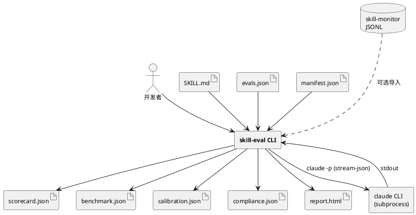

**系统边界**：
- **输入**：一个或多个 `SKILL.md` 文件所在目录 + 可选的 `evals.json` 评测定义
- **输出**：`benchmark.json` + `grading.json` + HTML 评测报告 + CLI exit code
- **外部依赖**：本地安装的 `claude` CLI（通过 `subprocess` 调用 `claude -p`）
- **不依赖**：Claude Code 运行时、OpenCode 运行时、任何第三方 API Key（复用 `claude` CLI 的认证）

### 2.2 组件架构图

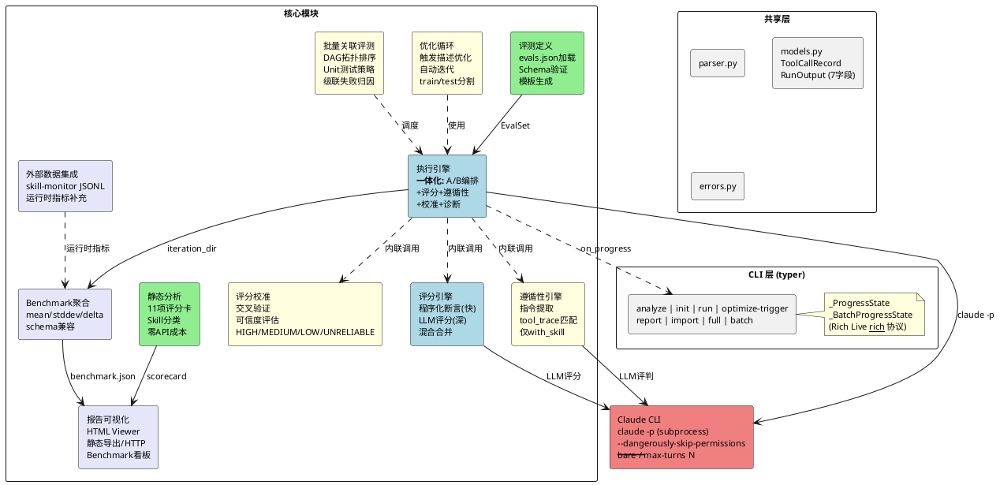

### 2.3 核心数据流

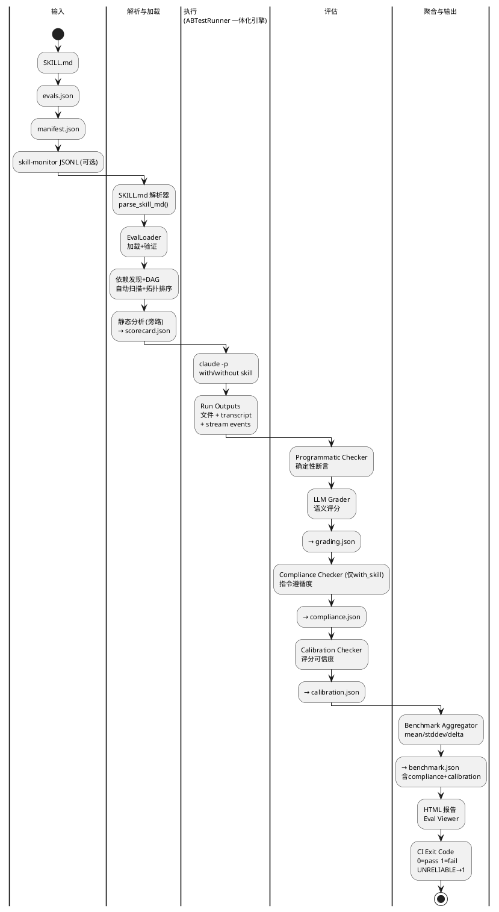

### 2.4 技术选型

| 层面 | 选型 | 理由 |
|------|------|------|
| 语言 | Python 3.10+ | 与 skill-creator 脚本一致 |
| CLI 框架 | typer >= 0.9 | 类型安全的命令定义，自动生成 help |
| 终端输出 | rich >= 13 | 表格、进度条、颜色 |
| 数据模型 | pydantic >= 2.0 | JSON schema 验证 + 序列化 |
| 并行执行 | concurrent.futures.ProcessPoolExecutor | 来自 skill-creator 的 run_eval.py |
| 子进程 | subprocess (claude -p) | 唯一与 Claude 的交互方式 |
| HTML 模板 | string.Template | 零依赖，移植自 generate_review.py |
| 包管理 | pyproject.toml | 标准 Python 项目 |
| 测试 | pytest | 单元测试 + 集成测试 |

**pyproject.toml 依赖声明**：

```toml
[project]
name = "skill-eval"
version = "0.1.0"
requires-python = ">=3.10"
dependencies = [
    "typer>=0.9",
    "rich>=13",
    "pydantic>=2.0",
    "pyyaml>=6.0",
]

[project.optional-dependencies]
dev = ["pytest>=7", "pytest-mock"]

[project.scripts]
skill-eval = "skill_eval.cli:app"

[build-system]
requires = ["hatchling"]
build-backend = "hatchling.build"
```

### 2.5 项目目录结构

```
skill-eval/
├── pyproject.toml
├── README.md
├── docs/
│   └── skill-eval-design.md          ← 本文档
│   └── skill-eval-arch-design.md     # 架构师版设计文档
│   └── skill-eval-principles.md      # 底层原理与参考出处
│
├── src/
│   └── skill_eval/
│       ├── __init__.py                # 版本号
│       ├── cli.py                     # typer CLI 入口
│       ├── models.py                  # 所有 Pydantic 数据模型
│       ├── parser.py                  # SKILL.md 解析器
│       ├── errors.py                  # 自定义异常 + 错误码
│       │
│       ├── security/
│       │   ├── __init__.py
│       │   └── vetter.py              # SecurityVetter (4 扫描器)
│       │
│       ├── config/                    # v0.2 配置驱动
│       │   ├── __init__.py
│       │   ├── loader.py              # 三层配置加载 + EvalConfig
│       │   ├── defaults.yaml          # 框架默认值
│       │   └── generator.py           # LLM 配置生成器
│       │
│       ├── scanning/                  # v0.2 L0 覆盖率扫描
│       │   ├── __init__.py
│       │   └── scanner.py             # scan_evals + validate + coverage
│       │
│       ├── static_analysis/
│       │   ├── __init__.py
│       │   ├── analyzer.py            # StaticAnalyzer 类
│       │   ├── checks.py              # 11 项检查函数
│       │   └── classifier.py          # Skill 分类器
│       │
│       ├── evals/
│       │   ├── __init__.py
│       │   ├── loader.py              # EvalLoader 类
│       │   └── generator.py           # EvalInitGenerator 类（config + mode 增强）
│       │
│       ├── execution/
│       │   ├── __init__.py
│       │   ├── runner.py              # ClaudeRunner + ABTestRunner
│       │   └── benchmark.py           # BenchmarkAggregator
│       │
│       ├── scoring/
│       │   ├── __init__.py
│       │   ├── programmatic.py        # ProgrammaticChecker (9 种断言 + 插件)
│       │   ├── llm_grader.py          # LLMGrader
│       │   ├── orchestrator.py        # ScoringOrchestrator
│       │   ├── plugins.py             # AssertionPluginRegistry (v0.2)
│       │   └── templates.py           # AssertionTemplateLibrary (v0.2)
│       │
│       ├── compliance/
│       │   ├── __init__.py
│       │   ├── extractor.py           # InstructionExtractor
│       │   └── checker.py             # ComplianceChecker
│       │
│       ├── calibration/
│       │   ├── __init__.py
│       │   └── calibrator.py          # CalibrationChecker
│       │
│       ├── optimization/
│       │   ├── __init__.py
│       │   ├── trigger_eval.py        # TriggerEvaluator
│       │   ├── description_improver.py # DescriptionImprover
│       │   └── loop.py               # OptimizationLoop
│       │
│       ├── reporting/
│       │   ├── __init__.py
│       │   ├── viewer.py              # ReportGenerator (HTML viewer)
│       │   ├── scorecard_renderer.py  # ScorecardRenderer
│       │   └── templates/
│       │       ├── viewer.html
│       │       └── scorecard.html
│       │
│       ├── integration/
│       │   ├── __init__.py
│       │   ├── monitor_importer.py    # MonitorImporter
│       │   ├── runner.py              # L2 集成测试 (chain/routing/contract) (v0.2)
│       │   └── impact.py              # 影响分析/爆炸半径 (v0.2)
│       │
│       └── batch/
│           ├── __init__.py
│           ├── manifest.py            # SkillsManifest + DependencyDiscovery
│           ├── dag.py                 # DAGBuilder + SkillDAG
│           ├── scheduler.py           # BatchScheduler
│           ├── cascade.py             # CascadeAnalyzer
│           └── reporter.py            # BatchResult 聚合
│
├── agents/                            # LLM prompt 模板 (纯文本 .md)
│   ├── grader.md
│   ├── compliance-judge.md            # 遵循性评判 prompt
│   ├── comparator.md
│   └── analyzer.md
│
└── tests/
    ├── conftest.py
    ├── fixtures/
    │   ├── sample-skill/              # 用于测试的最小 Skill
    │   │   ├── SKILL.md
    │   │   ├── scripts/
    │   │   │   └── validate.py
    │   │   └── references/
    │   │       └── guide.md
    │   ├── sample-evals.json
    │   └── sample-grading.json
    ├── test_parser.py
    ├── test_static_analysis.py
    ├── test_models.py
    ├── test_scoring_programmatic.py
    ├── test_extended_assertions.py      # v0.2: CROSS_FILE/CODE_COMPILES/PLUGIN
    ├── test_assertion_templates.py      # v0.2: 配置驱动模板
    ├── test_compliance.py
    ├── test_calibration.py
    ├── test_security.py
    ├── test_execution.py
    ├── test_batch.py
    ├── test_config_loader.py            # v0.2: 三层配置
    ├── test_config_generator.py         # v0.2: LLM 配置生成
    ├── test_eval_generator.py           # v0.2: config+mode 增强
    ├── test_scanner.py                  # v0.2: L0 覆盖率
    ├── test_integration.py              # v0.2: L2 集成测试
    └── test_impact.py                   # v0.2: 影响分析
```

### 2.6 与现有系统的关系及代码复用明细

| 来源文件 | 来源路径 | 目标文件 | 改造要点 |
|----------|----------|----------|----------|
| `scripts/utils.py` | skill-creator | `src/skill_eval/parser.py` | 直接移植 `parse_skill_md()` 函数 |
| `scripts/run_eval.py` | skill-creator | `src/skill_eval/optimization/trigger_eval.py` | 移植 `run_single_query()` 和 stream-json 解析，解耦 CLI 参数 |
| `scripts/aggregate_benchmark.py` | skill-creator | `src/skill_eval/execution/benchmark.py` | 移植 `generate_benchmark()` 和 `calculate_stats()`，类化为 BenchmarkAggregator |
| `scripts/improve_description.py` | skill-creator | `src/skill_eval/optimization/description_improver.py` | 移植 `_call_claude()` 和 prompt 模板，类化为 DescriptionImprover |
| `scripts/run_loop.py` | skill-creator | `src/skill_eval/optimization/loop.py` | 移植 `run_loop()` 和 `split_eval_set()`，类化为 OptimizationLoop |
| `scripts/generate_report.py` | skill-creator | `src/skill_eval/reporting/viewer.py` 的 trigger 报告部分 | 移植 `generate_html()` |
| `eval-viewer/generate_review.py` | skill-creator | `src/skill_eval/reporting/viewer.py` 的 eval viewer 部分 | 移植 `find_runs()`, `embed_file()`, `generate_html()`, HTTP server |
| `eval-viewer/viewer.html` | skill-creator | `src/skill_eval/reporting/templates/viewer.html` | 直接复制 |
| `agents/grader.md` | skill-creator | `agents/grader.md` | 直接复制，作为 LLMGrader 的 prompt 模板 |
| `agents/comparator.md` | skill-creator | `agents/comparator.md` | 直接复制，供后续盲审功能使用 |
| `agents/analyzer.md` | skill-creator | `agents/analyzer.md` | 直接复制，供 benchmark 分析使用 |
| `references/schemas.md` | skill-creator | `src/skill_eval/models.py` | 转为 Pydantic 数据模型 |
| skill-benchmark 11 项规则 | skill-benchmark SKILL.md | `src/skill_eval/static_analysis/checks.py` | 转为可执行检查函数 |
| skill-monitor JSONL 格式 | skill-monitor `src/index.ts` | `src/skill_eval/integration/monitor_importer.py` | 根据 `SkillCallData` 接口（TS）定义 Python 数据模型 |

---

## 3. 核心模块功能设计

### 3.0 安全审查引擎 (Security Vetting)

#### 3.0.1 模块职责

在安装或评测任何第三方 Skill 之前，对其目录进行多扫描器安全检查。检测恶意代码、硬编码凭证、Prompt 注入和结构异常。集成自 [skill-vetter](https://github.com/app-incubator-xyz/skill-vetter) 的安全扫描逻辑，以原生 Python 方式实现。

#### 3.0.2 类图

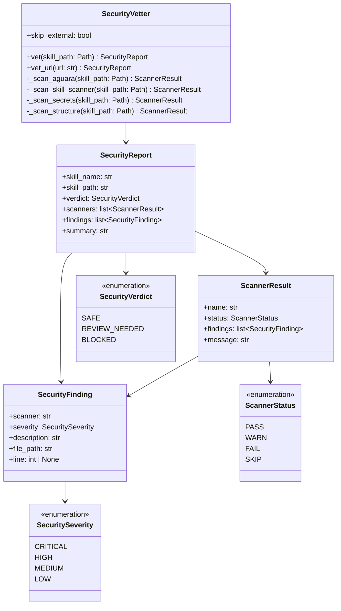

#### 3.0.3 四个扫描器

| # | 扫描器 | 实现方式 | 检查内容 | 依赖 |
|---|--------|----------|----------|------|
| 1 | **aguara** | subprocess 调用 `aguara scan --format json` | Prompt 注入、混淆、可疑 LLM 调用 | 可选（Go 二进制） |
| 2 | **skill-scanner** | subprocess 调用 `skill-scanner scan --format json` | 已知恶意模式、CVE 漏洞库 | 可选（pip: cisco-ai-skill-scanner） |
| 3 | **secrets-scan** | 原生 Python（re 正则匹配） | 硬编码 API Key、Token、凭证、Base64 编码字符串 | 无（总是可用） |
| 4 | **structure-check** | 原生 Python | 缺失 SKILL.md、缺少 YAML frontmatter、危险 shell 命令（`rm -rf`、`curl|bash`、`eval`） | 无（总是可用） |

**依赖降级策略**：外部扫描器（aguara、skill-scanner）未安装时自动 SKIP，不影响其他扫描器运行。使用 `--skip-external` 可显式禁用外部扫描器。

#### 3.0.4 SecurityVetter.vet() 流程

```
1. 解析 skill_path 为绝对路径

2. 依次运行四个扫描器：
   - aguara:       如果可用，解析 JSON 输出，按 severity 字段分级
   - skill-scanner: 如果可用，解析 JSON 输出，按 severity 字段分级
   - secrets-scan:  递归遍历 skill_path 下所有文本文件
                    模式: (api_key|secret|token|password|credential)\s*[:=]\s*['"][A-Za-z0-9_\-]{16,}['"]
                    额外检查: .sh/.py/.js/.ts 文件中的 Base64 编码字符串（≥40字符）
   - structure-check: 检查 SKILL.md 存在性、YAML frontmatter、危险命令模式

3. 汇总所有 findings，判定 verdict:
   - 任何 CRITICAL/HIGH → BLOCKED
   - 任何 MEDIUM（无 HIGH）→ REVIEW_NEEDED
   - 无 findings → SAFE

4. 返回 SecurityReport
```

#### 3.0.5 判定规则与动作

| Verdict | 含义 | 动作 |
|---------|------|------|
| **BLOCKED** | 存在 CRITICAL/HIGH 级别发现 | 不安装，不评测，exit code 1 |
| **REVIEW_NEEDED** | 存在 MEDIUM 级别发现 | 展示发现，由用户决定是否继续 |
| **SAFE** | 所有扫描器通过 | 可安全安装和评测 |

#### 3.0.6 security-report.json 输出格式

```json
{
  "skill_name": "some-skill",
  "skill_path": "/path/to/skill",
  "verdict": "BLOCKED",
  "scanners": [
    {
      "name": "aguara",
      "status": "SKIP",
      "findings": [],
      "message": "aguara not installed"
    },
    {
      "name": "secrets-scan",
      "status": "FAIL",
      "findings": [
        {
          "scanner": "secrets-scan",
          "severity": "HIGH",
          "description": "Hardcoded credentials detected",
          "file_path": "scripts/run.sh",
          "line": 12
        }
      ],
      "message": "Hardcoded credentials detected"
    },
    {
      "name": "structure-check",
      "status": "FAIL",
      "findings": [
        {
          "scanner": "structure-check",
          "severity": "HIGH",
          "description": "Dangerous shell command detected",
          "file_path": "scripts/run.sh",
          "line": 5
        }
      ],
      "message": "1 structure issue(s)"
    }
  ],
  "findings": [ ... ],
  "summary": "2 HIGH/CRITICAL, 0 MEDIUM"
}
```

#### 3.0.7 CLI 集成

**独立命令**：

```bash
skill-eval vet <skill-path> [--format table|json] [--output FILE] [--skip-external]
```

**安全门控 flag**：

```bash
skill-eval run <skill-path> --security-gate   # BLOCKED/REVIEW_NEEDED 时 exit code 1
skill-eval full <skill-path> --security-gate   # 同上，作为 Step 0 在评测前执行
```

**`skill-eval full --security-gate` 的流程变更**：

```
Step 0/5: Security vetting (新增，仅 --security-gate 时)
Step 1/5: Static analysis      (原 Step 1/4)
Step 2/5: Loading evals         (原 Step 2/4)
Step 3/5: Running A/B test      (原 Step 3/4)
Step 4/5: Aggregating & report  (原 Step 4/4)
```

### 3.1 静态分析引擎 (Static Analysis)

#### 3.1.1 模块职责

对 SKILL.md 文件进行零运行时成本的自动化体检。不调用任何 LLM，纯本地文件分析。

#### 3.1.2 类图

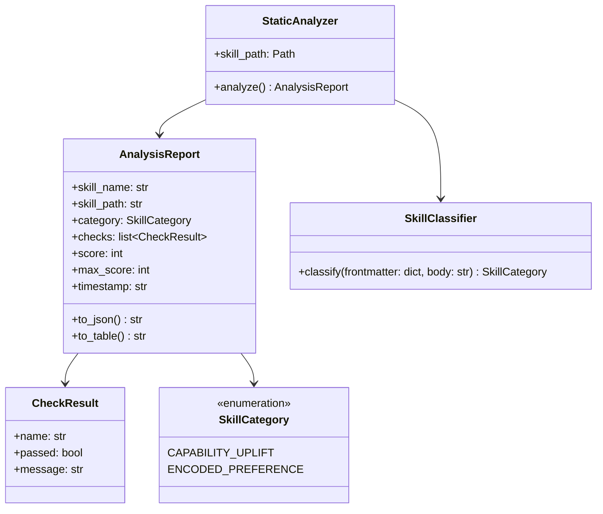

#### 3.1.3 检查函数签名

每个检查函数签名统一为：

```python
def check_xxx(skill_path: Path, content: str, frontmatter: dict, body: str) -> CheckResult
```

**11 项检查的实现规则**：

| # | name | Pass 条件 | 实现方式 | 失败 message 格式 |
|---|------|-----------|----------|-------------------|
| 1 | `description_length` | `frontmatter["description"]` 非空且 `len(description.strip()) <= 1024` | 读取 frontmatter 字段 | `"Description is {len} chars, max 1024"` 或 `"Description is empty"` |
| 2 | `description_has_trigger` | description 中包含以下任一（不区分大小写）：`"use when"`, `"activate when"`, `"用于"`, `"trigger"`, `"when the user"`, `"适用"` | `re.search(patterns, description, re.IGNORECASE)` | `"Description lacks trigger condition (e.g., 'Use when...')"` |
| 3 | `description_third_person` | description 中不包含以下模式：`"I can"`, `"I will"`, `"You can"`, `"You should"`, `"我会"`, `"你能"`, `"我可以"` | `re.search(patterns, description, re.IGNORECASE)` 取反 | `"Description uses first/second person: '{match}'"` |
| 4 | `name_kebab_case` | `frontmatter["name"]` 匹配 `^[a-z0-9]+(-[a-z0-9]+)*$`，且不以 `-` 开头/结尾，且不含 `--` | `re.match(pattern, name)` | `"Name '{name}' is not kebab-case"` |
| 5 | `name_max_64` | `len(name) <= 64` | `len(name)` | `"Name is {len} chars, max 64"` |
| 6 | `name_no_reserved` | name 不包含（不区分大小写）`"anthropic"`, `"claude"`, `"opencode"` | `re.search(patterns, name, re.IGNORECASE)` 取反 | `"Name contains reserved word: '{match}'"` |
| 7 | `skill_md_max_500_lines` | `content` 的行数 `<= 500` | `len(content.split("\n"))` | `"SKILL.md has {lines} lines, max 500"` |
| 8 | `has_examples` | body 中包含 `` ``` ``（三个反引号）或 heading 中包含 `"example"`（不区分大小写） | `re.search(r"```", body)` 或 `re.search(r"#.*example", body, re.IGNORECASE)` | `"SKILL.md has no examples"` |
| 9 | `reference_depth` | `skill_path/references/` 下的每个子目录不包含再下一级子目录。若 `references/` 不存在，直接 pass | `os.walk()` 检查 depth | `"Nested reference found: {path}"` |
| 10 | `anti_fabrication` | body 中包含以下任一（不区分大小写）：`"anti-fabrication"`, `"do not fabricate"`, `"don't fabricate"`, `"防伪造"`, `"core:anti-fabrication"`, `"禁止编造"`, `"do not invent"` | `re.search(patterns, body, re.IGNORECASE)` | `"No anti-fabrication rules found"` |
| 11 | `source_documented` | `skill_path` 路径中包含 `/skills/` 或 `/.opencode/skills/` 或 `/.claude/commands/`，或 `skill_path` 的父目录存在 `sources.md` | 路径字符串匹配 + `os.path.exists(sources_md)` | `"Skill path not recognized as standard location"` |

#### 3.1.4 Skill 分类逻辑

`SkillClassifier.classify()` 的决策规则：

1. 读取 frontmatter 的 `description` 和 body 全文
2. 检查 body 中是否包含用户特定的格式模板（如 `ALWAYS use this exact template`、固定的 markdown heading 结构）或团队约定（如 `commit message format`、`team convention`）
3. 如果包含上述模式 → `ENCODED_PREFERENCE`
4. 否则 → `CAPABILITY_UPLIFT`

检测关键词（不区分大小写）：
- **ENCODED_PREFERENCE 信号**: `"exact template"`, `"always use"`, `"team convention"`, `"our standard"`, `"commit message format"`, `"format:"`, `"naming convention"`
- **CAPABILITY_UPLIFT 信号**: `"enhance"`, `"improve"`, `"better"`, `"analysis"`, `"review"`

规则：先检查 ENCODED_PREFERENCE 信号，命中则分类为 `ENCODED_PREFERENCE`；否则为 `CAPABILITY_UPLIFT`。

#### 3.1.5 SKILL.md 解析器 (parser.py)

```python
def parse_skill_md(skill_path: Path) -> tuple[str, str, str, dict, str]:
    """
    解析 SKILL.md 文件。

    Args:
        skill_path: SKILL.md 所在目录的 Path（不是文件本身）

    Returns:
        (name, description, full_content, frontmatter_dict, body_text)
        - name: frontmatter 中的 name 字段
        - description: frontmatter 中的 description 字段
        - full_content: 文件完整文本
        - frontmatter_dict: 解析后的 frontmatter 键值对（dict）
        - body_text: frontmatter 之后的正文部分（去掉 --- 之间的内容）
    """
```

实现规则：
1. 读取 `skill_path / "SKILL.md"` 的完整文本
2. 找到第一个 `---` 和第二个 `---`，中间为 frontmatter
3. 解析 frontmatter 为 dict（支持 YAML 多行描述 `|` 和 `>` 语法）
4. 第二个 `---` 之后的所有文本为 body
5. 如果文件不以 `---` 开头，抛出 `SkillParseError`

### 3.2 评测定义层 (Eval Definition)

#### 3.2.1 模块职责

定义、加载、验证、生成评测用例。是与 skill-creator 的 schema 兼容层。

#### 3.2.2 数据模型 (models.py 中的相关模型)

```python
class FixtureFile(BaseModel):
    """测试前置文件"""
    path: str          # 相对于 outputs_dir 的路径
    content: str = ""  # 文件内容

class EvalSet(BaseModel):
    """对应 evals.json 文件的完整结构"""
    skill_name: str
    evals: list[EvalCase]

class EvalCase(BaseModel):
    """单个评测用例（也可作为 checkpoint）"""
    id: int
    name: str = ""  # 描述性名称，用于 benchmark.json 的 eval_name。为空时默认为 f"eval-{id}"
    prompt: str
    expected_output: str
    files: list[str] = []
    expectations: list[str] = []
    assertions: list[Assertion] = []
    fixtures: list[FixtureFile] = []  # 测试前置文件，执行前 setup 到 outputs_dir
    level: str = "L1"                 # 测试层级：L1(单元级) / L2(Mock场景) / L3(全流程)

    def setup_fixtures(self, base_dir: Path) -> None:
        """将 fixtures 写入 base_dir"""
        for f in self.fixtures:
            target = base_dir / f.path
            target.parent.mkdir(parents=True, exist_ok=True)
            target.write_text(f.content, encoding="utf-8")

class Assertion(BaseModel):
    """程序化断言定义"""
    name: str
    type: AssertionType
    params: dict[str, Any] = {}

class AssertionType(str, Enum):
    FILE_EXISTS = "FILE_EXISTS"
    CONTAINS_PATTERN = "CONTAINS_PATTERN"
    JSON_HAS_FIELD = "JSON_HAS_FIELD"
    LINE_COUNT = "LINE_COUNT"
    NOT_CONTAINS = "NOT_CONTAINS"
    CUSTOM_SCRIPT = "CUSTOM_SCRIPT"
```

#### 3.2.3 EvalLoader

```python
class EvalLoader:
    """加载和验证 evals.json"""

    def load(self, path: Path) -> EvalSet:
        """
        从 path 加载 evals.json 并验证。
        验证规则:
        - skill_name 非空
        - evals 非空
        - 每个 eval 的 id 唯一
        - 每个 eval 的 prompt 非空
        - files 中引用的文件路径相对于 evals.json 所在目录存在
        抛出 EvalValidationError 如果验证失败
        """

    def init_template(self, skill_path: Path, output_path: Path) -> Path:
        """
        生成 evals.json 模板文件到 output_path。
        模板包含 2 个空 eval case 占位。
        返回生成的文件路径。
        """
```

#### 3.2.4 EvalInitGenerator

```python
class EvalInitGenerator:
    """生成评测用例，支持 L1 单元级（默认）和模板模式"""

    def generate_with_llm(self, skill_path: Path) -> EvalSet:
        """
        调用 claude -p 自动生成 L1 单元级测试用例（默认模式）。

        LLM Prompt 要求生成 6 类测试：
        1. 输入验证（Input Validation）
        2. 决策逻辑（Decision Logic）
        3. 调度排序（Scheduling/Ordering）
        4. Skill 绑定（Skill Binding）
        5. 错误处理（Error Handling）
        6. 输出格式（Output Format）

        每个 eval 包含:
        - level: "L1"
        - prompt: 针对单一规则/行为的具体提问
        - expectations: 可验证的具体陈述
        - fixtures: []（大多数 L1 测试不需要 fixture）

        如果 LLM 调用失败，回退到 generate_template()。
        """

    def generate_template(self, skill_path: Path) -> EvalSet:
        """
        按 SKILL.md 的 ## 二级标题拆分，生成模板级 eval。
        作为 --no-generate-prompts 的回退方案。
        """
```

**`skill-eval init` 命令**默认使用 `--generate-prompts`（即 `generate_with_llm`），用 `--no-generate-prompts` 切换到模板模式。

### 3.3 执行引擎 (Execution Engine)

#### 3.3.1 模块职责

对每个 eval case，并行运行 with_skill 和 without_skill（baseline），收集输出文件、transcript 和 timing 数据。

#### 3.3.2 类图

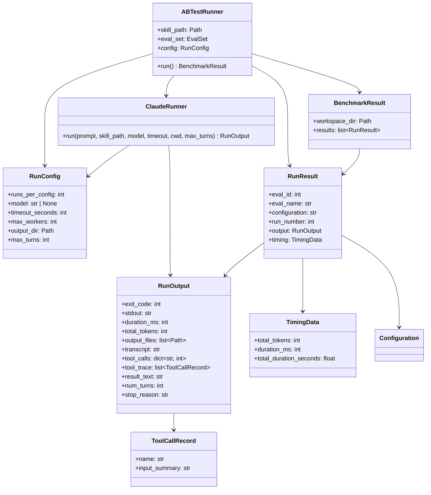

#### 3.3.3 ClaudeRunner 实现规则

**统一 `run(prompt, skill_path=None, model=None, timeout=120, cwd=None, max_turns=10)` 方法**：

`skill_path` 为 `None` 时走无 skill 路径，非 `None` 时走有 skill 路径。无需两个方法。

1. 如果 `skill_path` 非 None，将 SKILL.md 内容写入 `<project_root>/.claude/commands/<skill-name>-skill-<uuid>.md`
2. 构建命令：
   ```python
   cmd = ["claude", "-p", prompt, "--output-format", "stream-json", "--verbose",
          "--dangerously-skip-permissions",
          "--max-turns", str(max_turns)]
   if not skill_path:
       cmd.append("--bare")  # 跳过 skill/MCP 发现，加速启动
   if model:
       cmd.extend(["--model", model])
    result = subprocess.Popen(cmd, stdin=subprocess.PIPE, stdout=subprocess.PIPE, stderr=subprocess.PIPE, cwd=str(project_root), env=env)
    stdout_bytes, stderr_bytes = proc.communicate(timeout=timeout)
    ```
3. 使用 `subprocess.Popen` + `communicate(timeout)` + `proc.kill()`（`subprocess.run(timeout=N)` 对 claude 子进程超时不可靠）
4. 收集：
   - `duration_ms`：从 `result` 事件的 `duration_ms` 字段提取
   - `total_tokens`：从 `result` 事件的 `total_tokens` 字段提取
   - `transcript`：从 `assistant` 事件中所有 `type == "text"` 的 content 拼接
   - `tool_calls`：`dict[str, int]`，统计每个工具名称出现次数
   - `tool_trace`：`list[ToolCallRecord]`，每次 tool_use 的 name + input_summary（JSON 前 200 字符）
   - `result_text`：从 `result` 事件的 `result` 字段提取
   - `num_turns`：从 `result` 事件的 `num_turns` 字段提取
   - `stop_reason`：从 `result` 事件的 `stop_reason` 或 `subtype` 字段提取
5. 清理 `.claude/commands/` 下的临时文件（`finally` 块）
6. 环境变量处理：移除 `CLAUDECODE` 环境变量
7. 如果 `claude` CLI 不在 PATH 中，抛出 `ClaudeRunnerError`

**`without_skill` 模式**：`skill_path=None`，不创建临时文件，附加 `--bare` flag。

**临时文件的线程安全性**：临时命令文件名使用 `uuid.uuid4().hex[:8]` 保证唯一，多进程并发不会冲突。

**`<project_root>` 的发现逻辑**：

从 `skill_path` 开始向上遍历，找到包含 `.claude/` 目录的最近祖先目录。如果找不到，使用 `skill_path` 本身。

#### 3.3.4 ABTestRunner.run_ab_test() 流程

`ABTestRunner.__init__(config: RunConfig, scoring_config: ScoringConfig, on_progress: ProgressCallback | None = None)`

**单次 AB 测试 + Checkpoint 覆盖率模型**：

evals.json 中的每个 EvalCase 不再独立执行，而是作为 **checkpoint**。整个 skill 只跑一次 `claude -p`（with_skill 和 without_skill 各一次），然后用所有 checkpoint 的 expectations 检查 transcript 覆盖率。

```
merged_prompt = _build_merged_prompt(eval_set)  # 合并所有 eval prompt

for config_name in ("with_skill", "without_skill"):
    for run_number in 1..runs_per_config:
        1. eval_case.setup_fixtures(outputs_dir)  # 预置 fixture 文件
        2. emit_progress(phase="executing")
           ClaudeRunner.run(merged_prompt, skill_path or None, model, timeout, max_turns)
           catch ClaudeRunnerError → save error.txt, grading=0, continue
        3. save timing.json
        4. emit_progress(phase="scoring", substep="batch checking N checkpoints")
           _score_checkpoints(eval_cases, transcript, outputs_dir)
               → ONE batch claude -p call for ALL checkpoint expectations
               → all_expectations + per_checkpoint breakdown
           save grading.json (overall) + checkpoints.json (per-checkpoint)
        5. if with_skill:
               emit_progress(phase="compliance", substep="checking X/Y")
               InstructionExtractor.extract(skill_body) → instructions
               ComplianceChecker.check(instructions, transcript, output_dir, ...)
                   → _check_llm_batch: ONE claude -p for all LLM_JUDGE instructions
                   → max 30 instructions, 90s timeout
                   → on_substep callback, compliance.log
               save compliance.json
        6. emit_progress(phase="calibration")
           CalibrationChecker.calibrate(grading, compliance_report?) → save calibration.json
        7. save run_debug.json
        8. emit_progress(grading, run_duration, run_output)
```

**ABTestRunner 是一体化引擎：执行 → 评分 → 遵循性检查 → 评分校准 → 诊断输出，全部在内部完成。** CLI 层只需调用 `run_ab_test()` 一次即可获得完整结果。

**`_build_merged_prompt(eval_set)`**：将所有 eval case 的 prompt 合并为一个完整 prompt，格式为 "Please complete ALL of the following tasks in sequence: ## {name}\n{prompt}..."。

**`_score_checkpoints(eval_cases, transcript, outputs_dir)`**：
- 收集所有 checkpoint 的 expectations，构建全局索引
- 一次批量 `claude -p` 调用（prompt 包含所有 expectations），让 LLM 逐条判断 passed/evidence
- 同时对有 assertions 的 checkpoint 运行 ProgrammaticChecker
- 返回 `(all_expectations, per_checkpoint_list)`，写入 `grading.json` 和 `checkpoints.json`

**错误恢复**：`ClaudeRunnerError` 在每次 run 内被捕获，失败 run 写 `error.txt`，生成空 GradingResult（pass_rate=0），继续执行下一个 run，不中断整个测试。

**输出目录结构**：

```
<output_dir>/
└── iteration-1/
    ├── merged_prompt.txt              # 合并后的完整 prompt
    ├── with_skill/
    │   └── run-1/
    │       ├── outputs/
    │       │   └── (fixture 文件 + claude 输出)
    │       ├── timing.json
    │       ├── grading.json           # 所有 expectations 总体结果
    │       ├── checkpoints.json       # 每个 checkpoint 的独立覆盖率
    │       ├── compliance.json        # 指令遵循性（仅 with_skill）
    │       ├── compliance.log         # 逐条检查日志
    │       ├── calibration.json
    │       └── run_debug.json
    ├── without_skill/
    │   └── run-1/
    │       ├── grading.json
    │       ├── checkpoints.json
    │       ├── error.txt              # 如果 claude -p 失败
    │       └── ...
    └── benchmark.json
```

#### 3.3.5 BenchmarkAggregator

移植自 `aggregate_benchmark.py`。核心方法：

```python
class BenchmarkAggregator:
    def aggregate(self, workspace_dir: Path, skill_name: str) -> BenchmarkData:
        """
        直接扫描 workspace_dir 下的 with_skill/ 和 without_skill/ 目录，
        读取 {config}/run-*/grading.json，计算每个 configuration 的统计数据。

        **前置条件**：所有 run 的 grading.json 必须已存在（评分完成后才能调用）。
        如果某个 run 目录下没有 grading.json，跳过该 run 并打印 warning 到 stderr。

        **字段映射**：
        - grading.json summary.pass_rate → run result.pass_rate
        - grading.json timing.total_duration_seconds → run result.time_seconds
        - grading.json timing.total_tokens → run result.tokens
        - grading.json execution_metrics.total_tool_calls → run result.tool_calls
        - grading.json execution_metrics.errors_encountered → run result.errors
        - grading.json expectations → run expectations（直接传递，要求 text/passed/evidence 字段）

        输出 benchmark.json（格式见附录 A）。
        """
```

`calculate_stats(values: list[float]) -> dict` 计算 `{"mean", "stddev", "min", "max"}`。

### 3.4 评分引擎 (Scoring Engine)

#### 3.4.1 模块职责

评估执行结果。支持三种模式：`hybrid`（默认）、`programmatic`、`llm`。

#### 3.4.2 类图

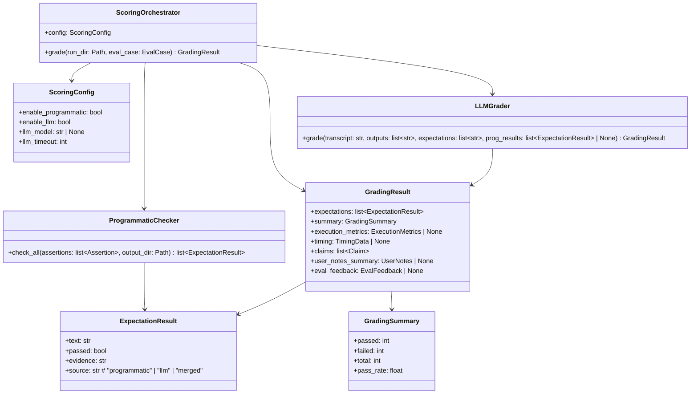

#### 3.4.3 ScoringOrchestrator.grade() 流程

```
1. 如果 config.enable_programmatic:
     prog_results = ProgrammaticChecker.check_all(assertions, output_dir)
   否则:
     prog_results = None

2. 如果 config.enable_llm:
     llm_result = LLMGrader.grade(transcript, outputs, expectations, prog_results)
   否则:
     llm_result = None

3. 合并:
   - 如果仅有 prog_results: 直接构建 GradingResult，source="programmatic"
   - 如果仅有 llm_result: 直接使用 llm_result
   - 如果两者都有:
     **合并策略：两个来源的 expectations 是独立的，不做 key 对齐合并。**
     1. 将 prog_results 的所有 ExpectationResult 加入最终列表，source="programmatic"
     2. 将 llm_result 的所有 ExpectationResult 加入最终列表，source="llm"
     3. summary 按 combined 列表重新计算 passed/failed/total/pass_rate
     4. 如果 prog_results 和 llm_result 对同一期望文本有冲突判定（prog.pass != llm.pass），以 llm 为准，移除 prog 版本，保留 llm 版本，source="merged"

4. 计算 summary: passed / failed / total / pass_rate

5. 保存 grading.json 到 run_dir
```

#### 3.4.4 ProgrammaticChecker 断言实现

| type | 实现伪代码 |
|------|-----------|
| `FILE_EXISTS` | `os.path.exists(output_dir / params["filename"])` |
| `CONTAINS_PATTERN` | 读取 output_dir 下所有文本文件内容拼接为 `text`，执行 `re.search(params["pattern"], text)`。若 params 有 `"path"` 则只读指定文件 |
| `JSON_HAS_FIELD` | 读取 `output_dir / params["filename"]`，解析 JSON，递归搜索键名 `params["field"]` |
| `LINE_COUNT` | 读取指定文件（或 output_dir 下所有文本文件），统计行数。检查 `min <= count <= max` |
| `NOT_CONTAINS` | 与 `CONTAINS_PATTERN` 相反，`re.search()` 返回 None 时为 pass |
| `CUSTOM_SCRIPT` | `subprocess.run(["python", params["script"], *params.get("args", [])], cwd=output_dir)`，exit code 0 = pass |

每个断言返回 `ExpectationResult`：
- `text`: assertion.name
- `passed`: bool
- `evidence`: 具体找到了什么或没找到什么（如 `"Found pattern [HIGH] in output line 5"`）
- `source`: `"programmatic"`

#### 3.4.5 LLMGrader.grade() 实现

1. 读取 `agents/grader.md` 作为 prompt 模板
2. 替换模板中的占位符：
   - `{expectations}`: eval_case.expectations 列表（每行一条）
   - `{transcript_path}`: transcript 文件路径
   - `{outputs_dir}`: 输出目录路径
   - `{programmatic_results}`: 如果 prog_results 不为 None，格式化为 `"Programmatic checks:\n- xxx: PASS\n- yyy: FAIL\n"`
3. 调用 `claude -p`，prompt 通过 stdin 传入（因为可能很长）：
   ```python
   cmd = ["claude", "-p", "--output-format", "text", "--dangerously-skip-permissions", "--max-turns", "1"]
   if config.llm_model:
       cmd.extend(["--model", config.llm_model])
   proc = subprocess.Popen(cmd, stdin=subprocess.PIPE, stdout=subprocess.PIPE, stderr=subprocess.PIPE)
   stdout_bytes, stderr_bytes = proc.communicate(input=prompt.encode("utf-8"), timeout=config.llm_timeout)
   ```
4. 解析返回文本中的 JSON（在 ```` ```json ```` 代码块中），构建 `GradingResult`
5. 如果解析失败，返回一个只有 summary 的降级结果（`pass_rate=0`, `evidence="Failed to parse LLM response"`）

#### 3.4.6 grading.json 格式

完全兼容 skill-creator 的 schema（见附录 A）：

```json
{
  "expectations": [
    {"text": "...", "passed": true, "evidence": "..."}
  ],
  "summary": {"passed": 2, "failed": 1, "total": 3, "pass_rate": 0.67},
  "execution_metrics": {"tool_calls": {}, "total_tool_calls": 15, "total_steps": 6, "errors_encountered": 0},
  "timing": {"executor_duration_seconds": 165.0, "total_duration_seconds": 191.0},
  "claims": [],
  "user_notes_summary": {"uncertainties": [], "needs_review": [], "workarounds": []},
  "eval_feedback": null
}
```

**关键字段名必须严格使用**：`expectations`、`text`、`passed`、`evidence`、`summary`、`pass_rate`。viewer.html 依赖这些字段名。

### 3.5 遵循性引擎 (Compliance Engine)

#### 3.5.1 模块职责

系统化验证 Claude Code 在执行过程中是否真正遵循了 SKILL.md 中定义的工作流步骤、工具使用要求、约束规则和输出规范。与 ProgrammaticChecker（检查输出物）和 LLMGrader（检查预期达成）不同，遵循性引擎检查的是 **过程合规**——"是否按 Skill 定义的方式执行"，而非仅仅"输出是否正确"。

**核心区别**：

| 维度 | 检查对象 | 已有模块 |
|------|----------|----------|
| 输出正确性 | 最终产出是否符合预期 | ProgrammaticChecker + LLMGrader |
| **过程合规性** | 执行过程是否遵循 SKILL.md 指令 | **ComplianceChecker（本节）** |
| 评分可信度 | 评分结果本身是否可靠 | CalibrationChecker（3.6 节） |

#### 3.5.2 类图

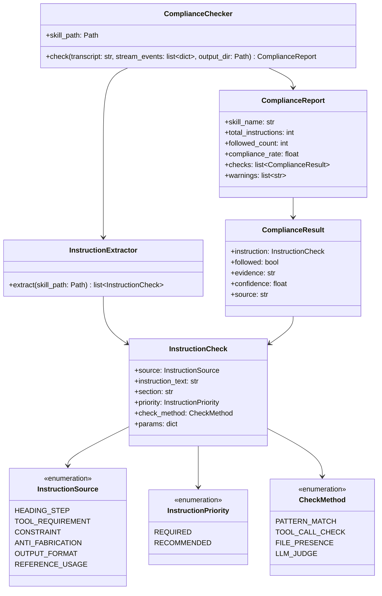

#### 3.5.3 InstructionExtractor — 指令提取

从 SKILL.md 中自动提取可检查的指令。提取规则：

**1. HEADING_STEP（工作流步骤）**

解析 body 中的有序/无序列表和标题结构：
- 匹配模式：`## Step N:`、`### N.`、`1. `、`- ` 后跟祈使句（以动词开头）
- 提取为 `InstructionCheck`，`check_method = LLM_JUDGE`（步骤是否被执行需要语义判断）
- `priority = REQUIRED`

提取伪代码：
```
for each section_heading in body:
    collect list items under this heading
    for each item matching imperative pattern (verb.*object):
        create InstructionCheck(
            source=HEADING_STEP,
            instruction_text=item,
            section=section_heading,
            priority=REQUIRED,
            check_method=LLM_JUDGE
        )
```

**2. TOOL_REQUIREMENT（工具/脚本使用要求）**

检测 SKILL.md 中要求使用的特定工具或脚本：
- 匹配模式：`"run <script>"`、`"use <tool>"`、`"execute <command>"`、`"python <path>"`、`<path>.py`、`<path>.sh`
- 提取脚本路径和工具名称
- `check_method = TOOL_CALL_CHECK`
- `priority = REQUIRED`

提取伪代码：
```
match patterns:
    r"(?:run|execute|use)\s+[`'\"]?([\w/\-\.]+\.(?:py|sh|js|ts))[`'\"]?" → script path
    r"(?:tool|command):\s*[`'\"]?(\w+)[`'\"]?" → tool name
for each match:
    create InstructionCheck(
        source=TOOL_REQUIREMENT,
        instruction_text=match,
        section=current_section,
        priority=REQUIRED,
        check_method=TOOL_CALL_CHECK,
        params={"tool_name": ..., "script_path": ...}
    )
```

**3. CONSTRAINT（约束规则）**

检测禁止性指令和约束条件：
- 匹配模式：`"NEVER"`, `"ALWAYS"`, `"MUST"`, `"MUST NOT"`, `"DO NOT"`, `"禁止"`, `"不得"`, `"必须"`, `"不要"`
- `check_method = LLM_JUDGE`
- `priority = REQUIRED`

**4. ANTI_FABRICATION（防伪造规则）**

复用静态分析 `anti_fabrication` 检查的检测结果，额外提取具体规则内容：
- 如果 SKILL.md 包含 anti-fabrication 段落，提取该段落的约束性语句
- `check_method = LLM_JUDGE`
- `priority = REQUIRED`

**5. OUTPUT_FORMAT（输出格式要求）**

检测输出格式约定：
- 匹配模式：code block 中的模板、`"output format:"`、`"use this template"`、JSON schema 定义
- `check_method = PATTERN_MATCH` 或 `FILE_PRESENCE`
- `priority = RECOMMENDED`

**6. REFERENCE_USAGE（引用文件使用）**

检测 SKILL.md 中引用的 `references/` 或 `scripts/` 目录下的文件：
- 扫描 body 中所有相对路径引用（`references/xxx`、`scripts/xxx`）
- `check_method = TOOL_CALL_CHECK`（检查 transcript 中是否读取/执行了这些文件）
- `priority = RECOMMENDED`

#### 3.5.4 ComplianceChecker.check() — 遵循度检查流程

```python
def check(
    self,
    instructions: list[InstructionCheck],  # 由调用方从 skill_body 预提取
    transcript: str,
    output_dir: Path,
    grading: GradingResult | None = None,
    model: str | None = None,
    timeout: int = 120,
    tool_trace: list[ToolCallRecord] | None = None,  # 从 RunOutput.tool_trace 传入
) -> ComplianceReport
```

**关键变化**：instructions 和 tool_trace 均由调用方（ABTestRunner）传入，而非 ComplianceChecker 自行提取或解析 stream_events。

**LLM_JUDGE 资源控制**（批量处理，防止指令数爆炸）：

| 参数 | 值 | 说明 |
|------|-----|------|
| `_BATCH_TIMEOUT` | 90s | 一次批量 `claude -p` 调用的超时 |
| `_MAX_LLM_IN_BATCH` | 30 条 | 单次批量最多处理 30 条 LLM_JUDGE 指令 |
| `_SINGLE_TIMEOUT` | 30s | 回退单条检查时的超时（`_check_llm_single`） |

超出 30 条的 LLM_JUDGE 指令标记为 `Skipped: LLM check budget (30) exhausted`。

```
1. instructions 由调用方通过 InstructionExtractor.extract(skill_body) 预提取
   如果 instructions 为空，返回空的 ComplianceReport（compliance_rate=0.0）

2. 按 check_method 分类：
   - TOOL_CALL_CHECK / PATTERN_MATCH / FILE_PRESENCE → 逐条程序化检查
   - LLM_JUDGE → 收集后批量处理

3. 程序化检查（逐条）：
   a) TOOL_CALL_CHECK 类:
      优先使用 tool_trace 精确匹配，回退到 transcript 文本匹配
   b) PATTERN_MATCH / FILE_PRESENCE 类:
      检查 transcript（过程）或 output_dir（产物）
   每条检查后通过 on_substep 回调更新进度，写入 log_path

4. LLM_JUDGE 批量检查（_check_llm_batch）：
   a) 收集所有 LLM_JUDGE 指令，截取前 30 条
   b) 构建批量 prompt，包含所有指令的 section/priority/instruction_text
   c) 一次 claude -p 调用（--max-turns 1, timeout=90s）
   d) 解析返回的 JSON 数组，按 index 对齐到指令
   e) 超出的指令标记 skipped
   f) 每条结果通过 on_substep 回调更新进度

5. 组装 ComplianceReport:
   - compliance_rate = followed_count / total_instructions
   - 跳过的指令计入 total_instructions（分母）
```

**on_substep 回调**：`(step: int, total: int, text: str, followed: bool, confidence: float)`，由 ABTestRunner 转发为进度条更新。

**compliance.log**：每条检查结果实时追加写入 `run_dir/compliance.log`，格式为 `[PASS/FAIL] step/total [source] conf=X.X instruction_text`。

#### 3.5.5 LLM 遵循性评判 Prompt (agents/compliance-judge.md)

```markdown
# Compliance Judge Agent

Evaluate whether the execution transcript followed the SKILL.md instructions.

## Inputs

- **instructions**: List of instructions extracted from SKILL.md
- **transcript_path**: Path to the execution transcript
- **outputs_dir**: Directory containing output files

## Task

For each instruction, determine:
1. Was this instruction followed during execution?
2. What specific evidence supports your judgment?
3. How confident are you (0.0-1.0)?

## Output Format

Return a JSON array:

```json
[
  {
    "instruction_index": 0,
    "followed": true,
    "evidence": "Transcript Step 3 shows: executing 'python scripts/validate.py'",
    "confidence": 0.95
  },
  {
    "instruction_index": 1,
    "followed": false,
    "evidence": "No evidence of running the required security scan script",
    "confidence": 0.8
  }
]
```

## Guidelines

- **PASS (followed=true)**: Clear evidence in the transcript that the instruction was executed as specified
- **FAIL (followed=false)**: No evidence found, or the instruction was explicitly violated
- **Evidence**: Quote specific text from the transcript or describe file contents
- **Confidence**: 
  - 0.9-1.0: Explicit evidence (exact command, tool call, or output matching)
  - 0.7-0.9: Strong indirect evidence (result implies the step was followed)
  - 0.5-0.7: Weak or ambiguous evidence
  - Below 0.5: Cannot determine (treat as not followed, burden of proof on compliance)
```

#### 3.5.6 compliance.json 输出格式

```json
{
  "skill_name": "string",
  "total_instructions": 8,
  "followed_count": 6,
  "compliance_rate": 0.75,
  "checks": [
    {
      "instruction": {
        "source": "TOOL_REQUIREMENT",
        "instruction_text": "Run scripts/validate.py to verify output",
        "section": "## Process",
        "priority": "REQUIRED",
        "check_method": "TOOL_CALL_CHECK"
      },
      "followed": true,
      "evidence": "Tool call 'Bash' with command 'python scripts/validate.py' found in transcript",
      "confidence": 1.0,
      "source": "programmatic"
    },
    {
      "instruction": {
        "source": "CONSTRAINT",
        "instruction_text": "NEVER modify files outside the target directory",
        "section": "## Rules",
        "priority": "REQUIRED",
        "check_method": "LLM_JUDGE"
      },
      "followed": false,
      "evidence": "Transcript shows Write tool modifying /etc/config.yaml which is outside target dir",
      "confidence": 0.9,
      "source": "llm"
    }
  ],
  "warnings": []
}
```

保存路径：与 `grading.json` 同级目录（`{run_dir}/compliance.json`）。

#### 3.5.7 与评分引擎的集成

遵循性检查在评分之后、聚合之前运行。集成方式：

```
ScoringOrchestrator.grade() → grading.json
ComplianceChecker.check() → compliance.json
CalibrationChecker.calibrate(grading, compliance?) → calibration.json
BenchmarkAggregator.aggregate() → 合并 grading + compliance + calibration 到 benchmark.json
```

**Compliance 结果对 benchmark.json 的影响**：

`benchmark.json` 的 `runs[]` 中新增 `compliance` 字段：

```json
{
  "eval_id": 1,
  "configuration": "with_skill",
  "run_number": 1,
  "result": { ... },
  "expectations": [ ... ],
  "compliance": {
    "compliance_rate": 0.75,
    "followed_count": 6,
    "total_instructions": 8,
    "required_followed": 5,
    "required_total": 6
  },
  "notes": []
}
```

**without_skill 配置不运行 ComplianceChecker**（因为没有加载 Skill，指令遵循无从谈起）。`compliance` 字段为 `null`。

**Compliance 结果对评分的调节**（可选，通过 CLI flag `--compliance-gate` 启用）：

如果启用 `--compliance-gate`，当 `compliance_rate < 0.5` 时，即使 expectations 全部通过，该 run 的 `result.pass_rate` 也被标记为 0（强制失败），并在 `notes` 中添加 `"Compliance gate triggered: compliance_rate=0.38 < threshold=0.5"`。理由：如果执行过程没有遵循 Skill 指令，输出正确可能是巧合，不应计入 Skill 的真实效果。

### 3.6 评分校准 (Scoring Calibration)

#### 3.6.1 模块职责

对评分结果本身进行元评估：交叉验证程序化断言与 LLM 评分的一致性，检测漏判/误判，产出评分可信度报告。解决的核心问题："我能不能相信这个评分？"

#### 3.6.2 类图

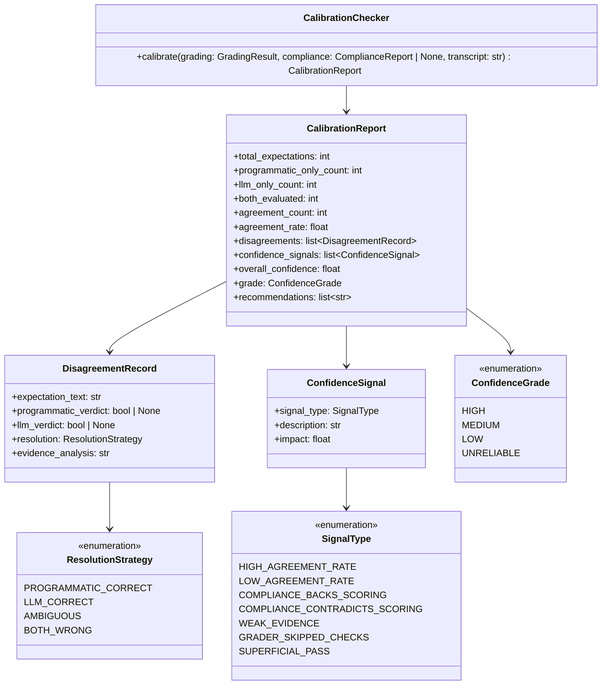

#### 3.6.3 CalibrationChecker.calibrate() 流程

```
1. 分歧检测 (Disagreement Detection):
   遍历 grading.expectations，按 text 字段匹配 programmatic 和 llm 结果
   对于两者都评估的 expectation:
     如果 prog.passed != llm.passed → 创建 DisagreementRecord
   分类：
     - programmatic=PASS, llm=FAIL → 可能是表面合规（superficial pass）
     - programmatic=FAIL, llm=PASS → 可能是程序化检查过严或 LLM 过宽
     - 记录 resolution:
       PROGRAMMATIC_CORRECT: 如果 compliance 报告中也标记了相关问题
       LLM_CORRECT: 如果程序化检查只验证了表面特征（如 FILE_EXISTS 只检查存在不检查内容）
       AMBIGUOUS: 无法判断
       BOTH_WRONG: 如果 compliance 发现两者都遗漏了关键问题

2. 可信度信号收集 (Confidence Signal Collection):
   计算以下信号：

   a) agreement_rate = agreement_count / both_evaluated
      如果 >= 0.9 → HIGH_AGREEMENT_RATE (impact +0.1)
      如果 < 0.6 → LOW_AGREEMENT_RATE (impact -0.2)

   b) 如果 compliance_report 不为 None:
      检查 compliance 结果是否与 scoring 结果一致
      例: scoring 说 PASS 但 compliance 发现关键步骤未遵循
      → COMPLIANCE_CONTRADICTS_SCORING (impact -0.3)
      反之 → COMPLIANCE_BACKS_SCORING (impact +0.1)

   c) 检查 grading.expectations 中的 evidence 质量:
      如果 evidence 长度 < 20 chars 或是模板化文本 → WEAK_EVIDENCE (impact -0.1)
      如果 LLM grading 的 claims 中有 verified=false → SUPERFICIAL_PASS (impact -0.15)

   d) 检查覆盖度:
      programmatic_only_count + llm_only_count / total
      如果 > 0.5 → GRADER_SKIPPED_CHECKS (impact -0.1)

3. 整体可信度计算:
   baseline_confidence = 0.7
   overall_confidence = baseline_confidence + sum(所有信号的 impact)
   clamp to [0.0, 1.0]

4. 可信度等级:
   HIGH:         overall_confidence >= 0.8
   MEDIUM:       overall_confidence >= 0.6
   LOW:          overall_confidence >= 0.4
   UNRELIABLE:   overall_confidence < 0.4

5. 建议生成:
   基于信号自动生成可操作建议，如:
   - "Programmatic assertion 'file_exists' passed but compliance shows the file was created with wrong content — consider using CONTAINS_PATTERN instead"
   - "LLM and programmatic results disagree on 40% of expectations — increase runs_per_config to reduce variance"
   - "Compliance rate is 0.38 but pass_rate is 0.92 — output quality may be coincidental, not skill-driven"
```

#### 3.6.4 calibration.json 输出格式

```json
{
  "total_expectations": 5,
  "programmatic_only_count": 2,
  "llm_only_count": 1,
  "both_evaluated": 2,
  "agreement_count": 1,
  "agreement_rate": 0.5,
  "disagreements": [
    {
      "expectation_text": "Output file contains valid JSON",
      "programmatic_verdict": true,
      "llm_verdict": false,
      "resolution": "LLM_CORRECT",
      "evidence_analysis": "Programmatic JSON_HAS_FIELD only checked field existence, not validity. LLM found malformed JSON structure."
    }
  ],
  "confidence_signals": [
    {
      "signal_type": "LOW_AGREEMENT_RATE",
      "description": "Only 50% agreement between programmatic and LLM grading",
      "impact": -0.2
    },
    {
      "signal_type": "COMPLIANCE_CONTRADICTS_SCORING",
      "description": "Scoring says PASS but compliance shows 2 required steps were skipped",
      "impact": -0.3
    }
  ],
  "overall_confidence": 0.35,
  "grade": "UNRELIABLE",
  "recommendations": [
    "Programmatic assertion 'JSON_HAS_FIELD' is too weak — consider adding CONTAINS_PATTERN for content validation",
    "Low agreement rate suggests increasing runs_per_config from 3 to 5 for statistical stability",
    "Compliance rate (0.38) contradicts pass rate (0.92) — the skill may not be the cause of good output"
  ]
}
```

保存路径：与 `grading.json` 同级目录（`{run_dir}/calibration.json`）。

#### 3.6.5 对 benchmark.json 的影响

`benchmark.json` 的 `runs[]` 中新增 `calibration` 字段：

```json
{
  "eval_id": 1,
  "configuration": "with_skill",
  "run_number": 1,
  "result": { ... },
  "expectations": [ ... ],
  "compliance": { ... },
  "calibration": {
    "grade": "HIGH",
    "overall_confidence": 0.85,
    "agreement_rate": 0.9,
    "disagreement_count": 0
  },
  "notes": []
}
```

**without_skill 配置也运行 CalibrationChecker**（此时只有 LLM 评分或只有 programmatic 断言，可以检查评分覆盖度和 evidence 质量）。

#### 3.6.6 Calibration 结果对聚合的影响

`run_summary` 中新增 `calibration_grade` 聚合字段：

```json
{
  "run_summary": {
    "with_skill": {
      "pass_rate": { "mean": 0.80, "stddev": 0.05, ... },
      "calibration_grade": "HIGH"
    },
    "without_skill": {
      "pass_rate": { "mean": 0.50, "stddev": 0.10, ... },
      "calibration_grade": "MEDIUM"
    }
  }
}
```

`calibration_grade` 取所有 run 中最低的 grade（保守策略）。

**如果 calibration_grade 为 UNRELIABLE**，`delta` 字段后追加警告注释：

```json
"delta": {
  "pass_rate": "+0.30 ⚠️ (scoring unreliable, confidence=0.35)",
  "time_seconds": "+13.0",
  "tokens": "+1700"
}
```

### 3.7 优化循环 (Optimization Loop)

#### 3.7.1 模块职责

自动化迭代优化 Skill 的触发描述（description 字段），直到目标精度达标。

#### 3.7.2 类图

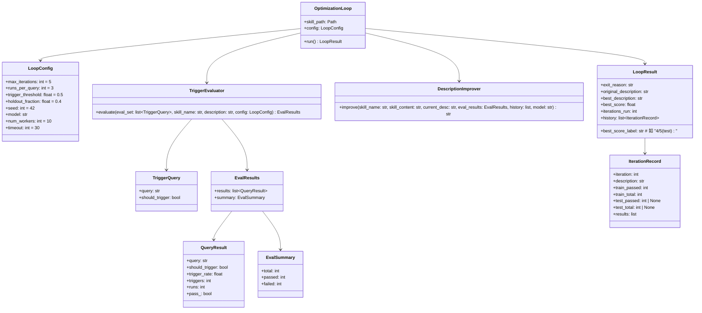

#### 3.7.3 TriggerEvaluator.evaluate() 实现

移植自 `run_eval.py`。核心逻辑：

1. 对 eval_set 中每个 query，spawn `runs_per_query` 个 `claude -p` 子进程
2. 每个 `claude -p` 命令的调用方式：
   - 在 `.claude/commands/` 下创建临时命令文件，内容为 skill 的 description
   - 运行 `claude -p query --output-format stream-json --verbose --include-partial-messages`
   - 解析 stream-json 事件流，检测模型是否调用了 `Skill` 或 `Read` 工具指向该命令文件
   - 如果检测到 → `triggered = True`，否则 → `triggered = False`
3. 使用 `ProcessPoolExecutor(max_workers=num_workers)` 并行
4. 每个查询的 `trigger_rate = triggers / runs`
5. `pass_` 判定：如果 `should_trigger` 则 `trigger_rate >= threshold` 为 pass；否则 `trigger_rate < threshold` 为 pass

#### 3.7.4 DescriptionImprover.improve() 实现

移植自 `improve_description.py`。核心逻辑：

1. 构建 prompt，包含：
   - 当前 description
   - 失败的触发查询（should_trigger=True 但没触发）
   - 误触发的查询（should_trigger=False 但触发了）
   - 历史尝试记录（附注"不要重复这些"）
   - Skill 全文内容
   - 改进指引（见 improve_description.py 中的 prompt）
2. 调用 `claude -p`（prompt 通过 stdin 传入）
3. 从返回文本中提取 `<new_description>...</new_description>` 标签中的内容
4. 如果新 description 超过 1024 字符，再做一次 shorten 调用
5. 返回新 description

#### 3.7.5 OptimizationLoop.run() 流程

```
1. 解析 SKILL.md，获取 name, original_description, content
2. 加载触发评测集（trigger_eval_set，由用户通过 --eval-set 指定）
3. 按 holdout_fraction 分割为 train_set (60%) 和 test_set (40%)，分层抽样（按 should_trigger 分组）

4. for iteration in 1..max_iterations:
     all_results = TriggerEvaluator.evaluate(train_set + test_set, name, current_description, config)
     按 query 拆分回 train_result_list 和 test_result_list

     记录 IterationRecord

     if train_set 全部通过:
       break ("all_passed")

     if iteration == max_iterations:
       break ("max_iterations")

     new_description = DescriptionImprover.improve(name, content, current_description, train_results, history, model)
     current_description = new_description

5. 选择 best iteration: 如果有 test_set，选 test_passed 最高的；否则选 train_passed 最高的

6. 返回 LoopResult
```

### 3.8 报告与可视化 (Reporting)

#### 3.8.1 模块职责

将评测结果转换为 HTML 页面，支持 HTTP 服务（交互模式）和静态文件导出（CI 模式）。

#### 3.8.2 类图

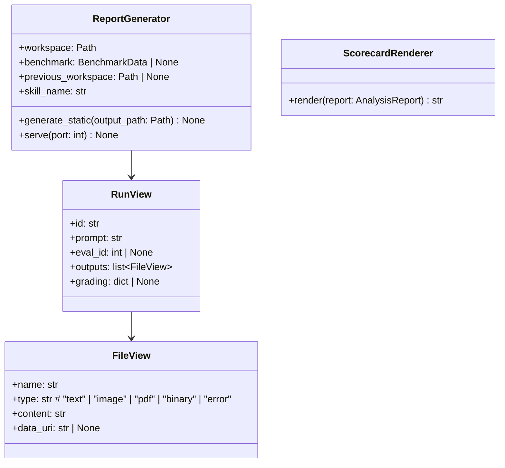

#### 3.8.3 ReportGenerator 实现规则

移植自 `generate_review.py`。

**`generate_static(output_path)`**:

1. 调用 `find_runs(workspace)` 递归扫描含 `outputs/` 子目录的目录
2. 对每个 run 调用 `build_run()` 构建 `RunView`
3. 加载 `previous_workspace` 的 feedback 和 outputs（如有）
4. 加载 `benchmark` JSON（如有）
5. 将所有数据 JSON 序列化，嵌入 `templates/viewer.html` 中替换 `/*__EMBEDDED_DATA__*/` 占位符
6. 写入 `output_path`

**`find_runs(workspace)` 递归规则**：
- 如果当前目录含 `outputs/` 子目录 → 是一个 run，构建 RunView
- 否则递归遍历子目录（跳过 `node_modules`, `.git`, `__pycache__`, `skill`, `inputs`）

**`embed_file(path)` 规则**：
- `.txt`, `.md`, `.json`, `.csv`, `.py`, `.js`, `.ts`, `.yaml`, `.yml`, `.xml`, `.html`, `.css`, `.sh`, `.go`, `.rs`, `.java`, `.c`, `.cpp`, `.h`, `.sql`, `.toml` → type="text"，直接读文本
- `.png`, `.jpg`, `.jpeg`, `.gif`, `.svg`, `.webp` → type="image"，base64 编码
- `.pdf` → type="pdf"，base64 编码
- 其他 → type="binary"，base64 编码

**`serve(port)`**：

启动 `http.server.HTTPServer`，GET `/` 返回 HTML（每次请求重新扫描 workspace），POST `/api/feedback` 保存 feedback.json。

**feedback.json 格式**（POST `/api/feedback` 的请求体和保存格式）：

```json
{
  "reviews": [
    {"run_id": "eval-0-with_skill", "feedback": "用户评价文本", "timestamp": "ISO 8601"},
    {"run_id": "eval-1-with_skill", "feedback": "", "timestamp": "ISO 8601"}
  ],
  "status": "complete"
}
```

保存路径：`{workspace}/feedback.json`。

#### 3.8.4 ScorecardRenderer

将 `AnalysisReport` 渲染为 HTML 表格。模板为 `templates/scorecard.html`。

### 3.9 外部数据集成 (Integration)

#### 3.9.1 模块职责

导入 skill-monitor 产出的 JSONL 日志，将运行时指标合并到 benchmark.json。

#### 3.9.2 MonitorImporter

```python
class MonitorImporter:
    def import_jsonl(self, jsonl_path: Path) -> list[RuntimeRecord]:
        """
        逐行读取 JSONL 文件，每行解析为 RuntimeRecord。
        跳过解析失败的行。
        """

    def merge_with_benchmark(self, records: list[RuntimeRecord], benchmark_path: Path) -> None:
        """
        读取 benchmark.json，将 records 中的运行时指标补充到匹配的 run 中。
        匹配规则:
        1. record.skill_name == benchmark.metadata.skill_name
        2. record.timestamp 在 benchmark.metadata.timestamp 附近（±24h）
        匹配到的 record 补充:
        - run.result.tokens = record.tokens.input + record.tokens.output + record.tokens.reasoning
        - run.result.time_seconds = record.duration / 1000
        写回 benchmark.json。
        """
```

**RuntimeRecord 模型**（对应 skill-monitor 的 `SkillCallData`）：

```python
class RuntimeRecord(BaseModel):
    timestamp: str
    skill_name: str
    agent_name: str | None = None
    tokens: RuntimeTokenUsage
    duration: int  # 毫秒
    success: bool
    session_id: str | None = None
    project_name: str | None = None
    trigger: str | None = None
    parent_skill: str | None = None
    call_chain: list[str] = []

class RuntimeTokenUsage(BaseModel):
    input: int
    output: int
    reasoning: int
    cache: RuntimeCacheUsage = RuntimeCacheUsage(read=0, write=0)

class RuntimeCacheUsage(BaseModel):
    read: int
    write: int
```

### 3.10 CLI 接口设计

#### 3.10.1 完整命令列表

`skill-eval` 使用 typer 定义以下子命令：

| 命令 | 签名 | 耗时 | 需要 claude CLI |
|------|------|------|----------------|
| `vet` | `skill-eval vet SKILL_PATH [--format FORMAT] [--output FILE] [--skip-external]` | <1s | 否 |
| `analyze` | `skill-eval analyze SKILL_PATH [--format FORMAT] [--output FILE]` | <1s | 否 |
| `init` | `skill-eval init SKILL_PATH [--output DIR] [--generate-prompts]` | <1s（无 --generate-prompts）/ ~30s（有） | 仅 --generate-prompts |
| `scan` | `skill-eval scan SKILLS_DIR [--config-prefix PREFIX] [--domain DOMAIN] [--type TYPE] [--format FORMAT]` | <1s | 否 |
| `generate-config` | `skill-eval generate-config SKILLS_DIR [--output FILE] [--model MODEL]` | ~30s | 是 |
| `run` | `skill-eval run SKILL_PATH [--evals PATH] [--runs N] [--model MODEL] [--workers N] [--timeout N] [--scoring MODE] [--compliance-gate] [--security-gate] [--no-calibration] [--output DIR]` | 5-30min | 是 |
| `optimize-trigger` | `skill-eval optimize-trigger SKILL_PATH --eval-set PATH [--max-iterations N] [--model MODEL]` | 10-60min | 是 |
| `report` | `skill-eval report WORKSPACE [--benchmark PATH] [--previous PATH] [--static FILE] [--port PORT] [--open]` | <1s | 否 |
| `import` | `skill-eval import JSONL_PATH --benchmark PATH` | <1s | 否 |
| `full` | `skill-eval full SKILL_PATH [--runs N] [--model MODEL] [--compliance-gate] [--security-gate] [--open]` | 5-30min | 是 |
| `batch` | `skill-eval batch MANIFEST_OR_DIR [--runs N] [--model MODEL] [--layers LAYERS] [--baseline PATH] [--fail-fast] [--workers N] [--output DIR]` | 30-120min | 是 |

#### 3.10.2 通用参数

| 参数 | 类型 | 说明 |
|------|------|------|
| `--format` | `json` \| `table` | 输出格式，默认 `table` |
| `--output` | Path | 输出路径 |
| `--verbose` | flag | 打印详细日志到 stderr |
| `--compliance-gate` | flag | 启用遵循性门控（compliance_rate < 0.5 时强制判定为失败） |
| `--security-gate` | flag | 启用安全门控（BLOCKED/REVIEW_NEEDED 时强制判定为失败） |
| `--no-calibration` | flag | 跳过评分校准（节省 LLM 调用成本） |

#### 3.10.3 Exit Code 规则

| Exit Code | 含义 |
|-----------|------|
| 0 | 所有检查/评测通过 |
| 1 | 存在失败项（静态检查失败 / 评测断言失败 / 回归检测失败） |
| 2 | 输入错误（SKILL.md 不存在、evals.json 格式错误等） |
| 3 | 执行错误（`claude -p` 调用失败、超时等） |

#### 3.10.4 `skill-eval full` 完整流程

```
0. (if --security-gate) SecurityVetter.vet(skill_path)
   if BLOCKED: exit code 1
   if REVIEW_NEEDED: exit code 1

1. StaticAnalyzer.analyze(skill_path) → scorecard.json
   if error: print warning, continue

2. EvalLoader.load(skill_path / "evals/evals.json")
   if not found: exit code 2

3. ABTestRunner.run_ab_test(skill_path, eval_set)  ← 一体化引擎
   内部完成（单次 AB + checkpoint 覆盖率）：
   - _build_merged_prompt(eval_set) → 合并所有 eval prompt
   - ClaudeRunner.run() × 2 configs × N runs
   - _score_checkpoints() → 批量 checkpoint 评分 → grading.json + checkpoints.json
   - ComplianceChecker.check() → 批量 LLM judge → compliance.json + compliance.log
   - CalibrationChecker.calibrate() → calibration.json
   - run_debug.json per run
   Rich Live 进度显示（含 phase + substep）

4. BenchmarkAggregator.aggregate(iteration_dir, skill_path)
   直接扫描 with_skill/ 和 without_skill/ 目录
   → benchmark.json
   ReportGenerator.write_static() → report.html
```

**CLI flags**: `--runs`, `--model`, `--workers`, `--timeout`, `--max-turns`, `--compliance-gate`, `--security-gate`, `--open`, `--format`, `--output`

### 3.11 实时进度显示

#### 3.11.1 `_ProgressState`（`full` 命令）

```python
class _ProgressState:
    def __init__(self, num_evals: int, runs_per_config: int):
        self.total_runs = 2 * runs_per_config  # 2 configs (with_skill + without_skill)
        self.completed: int = 0
        self.current_eval: str
        self.current_config: str  # "with_skill" | "without_skill"
        self.phase: str = ""      # "executing" | "scoring" | "compliance" | "calibration"
        self.substep: str = ""    # e.g. "checking 15/115", "5/22 checkpoints"
        self.results: list[dict]  # 每完成一个 run 追加一条
        self.live: Live | None    # Rich Live 实例

    def update(self, eval_name, config_name, eval_idx, completed, total,
               grading, run_duration=0.0, run_output=None, phase="", substep=""):
        # grading is None → run 正在启动，记录 start_time
        # grading is not None → run 完成，追加到 results

    def __rich__(self) -> Panel:
        # Rich Live 通过 __rich__ 协议每秒调用此方法获取渲染内容
```

**显示内容**：
- 进度条：`[████████░░░░░░░░] 53% (16/30 runs)`
- 当前运行：`[2/15] create-arkts-project  with_skill  ⏳ 142s`
- ETA：`Avg 87.3s/run · ETA 12m04s (14 left)`
- 最近 run 详情：pass_rate, tool_calls, num_turns, stop_reason, failed expectations
- 历史 run 列表（最近 4 条）

**关键实现**：`live.update(self, refresh=True)` 而非 `live.update(self.render())`，前者让 Rich Live 后台线程每秒调用 `__rich__()` 获取最新状态，后者会替换为静态 Panel 导致不更新。

#### 3.11.2 `_BatchProgressState`（`batch` 命令）

结构类似，但按 skill 维度追踪进度，内嵌一个 `_ProgressState` 实例追踪当前 skill 的 eval 进度。

---

## 4. 批量关联评测 (Batch Evaluation)

### 4.1 模块职责

对一组相互依赖的 Skills 执行分层评测：先逐个独立测试（Unit），再按依赖拓扑做集成测试（Integration），最后与历史基线做回归对比（Regression）。

### 4.2 核心概念

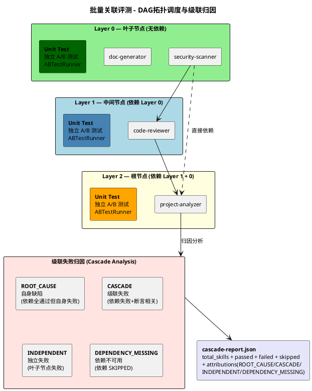

### 4.3 类图

```mermaid
classDiagram
    class SkillsManifest {
        +name: str
        +skills: list~SkillEntry~
        +integration_evals: list~IntegrationEval~
    }

    class SkillEntry {
        +path: str
        +depends_on: list~str~
        +evals_path: str | None
        +disabled: bool
    }

    class IntegrationEval {
        +id: int
        +prompt: str
        +expected_skills_triggered: list~str~
        +expectations: list~str~
        +assertions: list~Assertion~
    }

    class DependencyDiscovery {
        +root_dir: Path
        +discover() SkillsManifest
    }

    class DAGBuilder {
        +build(manifest: SkillsManifest) SkillDAG
    }

    class SkillDAG {
        +nodes: list~DAGNode~
        +edges: list~DAGEdge~
        +layers: list~DAGLayer~
        +get_ancestors(node_id: str) list~str~
    }

    class DAGNode {
        +skill_path: str
        +skill_name: str
        +layer: int
        +status: NodeStatus
    }

    class DAGEdge {
        +from_skill: str
        +to_skill: str
        +edge_type: EdgeType
    }

    class EdgeType {
        <<enumeration>>
        STATIC_DEP
        RUNTIME_CALL
        MANIFEST_DECLARED
    }

    class NodeStatus {
        <<enumeration>>
        PENDING
        RUNNING
        PASSED
        FAILED
        SKIPPED
        CASCADE_FAILED
    }

    class DAGLayer {
        +index: int
        +nodes: list~DAGNode~
    }

    class BatchScheduler {
        +dag: SkillDAG
        +config: BatchConfig
        +run() BatchResult
    }

    class BatchConfig {
        +runs_per_config: int
        +model: str | None
        +unit_tests: bool
        +integration_tests: bool
        +regression_baseline: Path | None
        +fail_fast: bool
        +max_workers: int
    }

    class CascadeAnalyzer {
        +analyze(results: dict, dag: SkillDAG) CascadeReport
    }

    class FailureChain {
        +failed_node: str
        +root_cause: str | None
        +chain: list~str~
        +failure_type: FailureType
    }

    class FailureType {
        <<enumeration>>
        ROOT_CAUSE
        CASCADE
        INDEPENDENT
        DEPENDENCY_MISSING
    }

    class CascadeReport {
        +root_causes: list~FailureChain~
        +cascade_failures: list~FailureChain~
        +independent_failures: list~FailureChain~
    }

    class BatchResult {
        +manifest_name: str
        +unit_results: dict~str, NodeTestResult~
        +integration_results: list~IntegrationResult~
        +cascade_report: CascadeReport
        +regression_delta: dict | None
        +summary: BatchSummary
    }

    class NodeTestResult {
        +skill_name: str
        +status: NodeStatus
        +failure_type: FailureType | None
        +unit_pass_rate: float
        +root_cause: str | None
        +failure_chain: list~str~
        +delta_vs_baseline: str | None
    }

    class IntegrationResult {
        +eval_id: int
        +prompt: str
        +triggered_skills: list~str~
        +expected_skills: list~str~
        +trigger_accuracy: float
        +grading: GradingResult | None
    }

    class BatchSummary {
        +total_skills: int
        +passed: int
        +failed: int
        +cascade_failed: int
        +skipped: int
        +overall_pass_rate: float
    }

    SkillsManifest --> SkillEntry
    SkillsManifest --> IntegrationEval
    DependencyDiscovery --> SkillsManifest
    DAGBuilder --> SkillDAG
    SkillDAG --> DAGNode
    SkillDAG --> DAGEdge
    SkillDAG --> DAGLayer
    DAGNode --> NodeStatus
    DAGEdge --> EdgeType
    BatchScheduler --> SkillDAG
    BatchScheduler --> BatchConfig
    BatchScheduler --> BatchResult
    BatchScheduler --> CascadeAnalyzer
    CascadeAnalyzer --> CascadeReport
    CascadeAnalyzer --> FailureChain
    FailureChain --> FailureType
    BatchResult --> NodeTestResult
    BatchResult --> IntegrationResult
    BatchResult --> CascadeReport
    BatchResult --> BatchSummary
```

### 4.4 执行顺序图

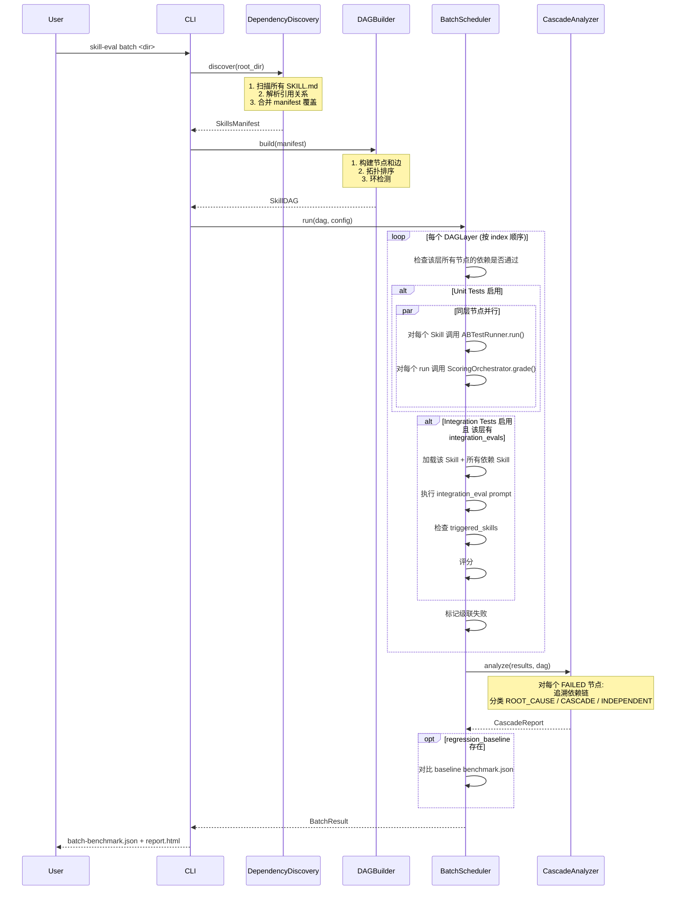

### 4.5 三层测试策略

| 层级 | 测试内容 | 触发条件 | 失败含义 |
|------|----------|----------|----------|
| **Unit** | 每个 Skill 独立 A/B 测试 | `--layers` 含 `unit` | Skill 自身缺陷 |
| **Integration** | 按 DAG 加载依赖链，测试 Skill 间协作 | `--layers` 含 `integration` | Skill 间交互问题 |
| **Regression** | 与上次 `batch-benchmark.json` 逐 Skill 对比 | `--layers` 含 `regression` 且 `--baseline` 指定 | 模型更新/代码变更导致退化 |

**Unit Tests**：复用 `ABTestRunner`，每个 Skill 独立执行。

**Integration Tests**：
1. 加载目标 Skill + 所有依赖 Skill（通过将它们的 SKILL.md 都放到 `.claude/commands/`）
2. 执行 `integration_eval` 中定义的 prompt
3. 从 stream-json 输出中检测哪些 Skill 被触发（通过检测 `assistant` 事件中 `type == "tool_use"` 且 `name == "Skill"` 的 tool call，读取 `input.skill` 中的 skill name）
4. 比较 `triggered_skills` 与 `expected_skills_triggered`
5. `trigger_accuracy = len(triggered ∩ expected) / len(expected)`
6. 对最终输出跑 assertions + LLM grading
7. **without_skills 对照组**：不向 `.claude/commands/` 放入任何 Skill，运行相同 prompt。用于对比有/无 Skill 链的输出质量差异

**Regression Tests**：
1. 加载 `--baseline` 指定的 `batch-benchmark.json`
2. 逐 Skill 对比 `unit_pass_rate`
3. **delta 定义**: `delta = current_pass_rate - baseline_pass_rate`
4. 判定规则：
   - `delta < -0.05` → **REGRESSED**（当前比基线差超过 5%，标记告警）
   - `delta >= -0.05 && delta <= 0.05` → **STABLE**
   - `without_skill_pass_rate >= with_skill_pass_rate` → **REDUNDANT**（标记"可退役"）

### 4.6 依赖发现机制

#### 4.6.1 DependencyDiscovery.discover() 规则

**输入**: `root_dir`（包含多个 Skill 目录的根目录）

**Step 1 - 扫描所有 Skill**:
- 遍历 `root_dir` 的子目录，找到所有含 `SKILL.md` 的目录
- 对每个 Skill 调用 `parser.parse_skill_md()` 获取 name, description, content, frontmatter, body

**Step 2 - 自动分析引用关系**:

对每个 Skill 的 body 文本（frontmatter 之后的部分，全部转小写），检查它是否引用了其他 Skill name：

| 模式 | 匹配方式 | 示例 |
|------|----------|------|
| 精确匹配 | body 中出现 `other-skill-name`，且前后不是字母/数字 | `code-reviewer` |
| 空格替换 | `code-reviewer` → `code reviewer`，同上 | "use the code reviewer" |
| 下划线替换 | `code-reviewer` → `code_reviewer`，同上 | `import code_reviewer` |
| 路径引用 | body 中包含路径指向其他 Skill 的 SKILL.md | `../security-scanner/SKILL.md` |

边界检查：匹配到的子串前后字符不能是 `[a-z0-9]`（避免 `my-code-reviewer` 误匹配 `code-reviewer`）。

**Step 3 - 合并 manifest 覆盖**:

如果 `root_dir` 下存在 `skills-manifest.json`：
- 加载 manifest 中的 `skills` 和 `depends_on`
- manifest 中显式声明的 `depends_on` 覆盖自动发现的结果
- manifest 中 `disabled: true` 的 Skill 跳过测试

**Step 4 - 环检测**:

使用 DFS 检测有向图中的环。如果发现环，抛出 `CyclicDependencyError`，列出环路径。

#### 4.6.2 skills-manifest.json 格式

```json
{
  "name": "project-name",
  "_path_note": "所有 path 字段相对于 skills-manifest.json 文件所在的目录",
  "skills": [
    {
      "path": "./skills/security-scanner",
      "depends_on": [],
      "evals_path": null,
      "disabled": false
    },
    {
      "path": "./skills/code-reviewer",
      "depends_on": ["./skills/security-scanner"],
      "evals_path": null,
      "disabled": false
    },
    {
      "path": "./skills/project-analyzer",
      "depends_on": ["./skills/code-reviewer", "./skills/security-scanner"],
      "evals_path": "./skills/project-analyzer/evals/evals.json",
      "disabled": false
    }
  ],
  "integration_evals": [
    {
      "id": 100,
      "prompt": "分析这个项目的安全性",
      "expected_skills_triggered": ["project-analyzer", "code-reviewer", "security-scanner"],
      "expectations": ["三个 skill 都被触发", "安全报告覆盖所有文件"],
      "assertions": []
    }
  ]
}
```

### 4.7 级联失败归因

`CascadeAnalyzer.analyze()` 对每个 `FAILED` 或 `CASCADE_FAILED` 节点执行：

```
for each node in dag.nodes where status == FAILED:
    deps = dag.get_ancestors(node.skill_name)

    if deps is empty:
        → INDEPENDENT (该 Skill 无依赖，失败是独立的)
        continue

    failed_deps = [d for d in deps if results[d].status in (FAILED, CASCADE_FAILED)]

    if failed_deps is empty:
        → ROOT_CAUSE (所有依赖通过，问题在该 Skill 自身)
        continue

    # 检查该节点的失败 assertion 是否与失败依赖的职责相关
    related = check_assertion_overlap(node.failed_expectations, failed_deps)

    if related:
        → CASCADE (级联失败，根因在依赖)
        node.root_cause = failed_deps[0].skill_name
        trace back to find the ROOT_CAUSE in the chain
    else:
        if all deps are CASCADE_FAILED or SKIPPED:
            → DEPENDENCY_MISSING (依赖完全不可用)
        else:
            → ROOT_CAUSE (失败与依赖无关)
```

`check_assertion_overlap()` 规则：如果失败 assertion 的文本中包含失败依赖的 `skill_name`（精确匹配 skill_name 或其空格/下划线变体），认为相关。否则不相关。

### 4.8 CLI 接口

```bash
skill-eval batch MANIFEST_OR_DIR \
  [--runs 3] \
  [--model MODEL] \
  [--layers unit,integration,regression] \
  [--baseline PATH] \
  [--fail-fast] \
  [--workers 6] \
  [--output DIR]
```

**参数说明**：

| 参数 | 默认值 | 说明 |
|------|--------|------|
| `MANIFEST_OR_DIR` | 必填 | `skills-manifest.json` 路径 或 包含多个 Skill 子目录的根目录 |
| `--layers` | `unit,integration,regression` | 逗号分隔，指定要执行的测试层 |
| `--baseline` | None | 上次的 `batch-benchmark.json`，用于回归对比 |
| `--fail-fast` | false | 任一 Skill Unit Test 失败立即停止 |
| `--output` | `./batch-workspace-<timestamp>` | 输出目录 |

**输出目录结构**：

```
batch-workspace-20260427/
├── manifest.json
├── dag.json
├── unit/
│   ├── security-scanner/
│   │   ├── eval-0/
│   │   │   ├── with_skill/...
│   │   │   └── without_skill/...
│   │   └── grading.json
│   ├── code-reviewer/
│   │   └── ...
│   └── project-analyzer/
│       └── ...
├── integration/
│   ├── eval-100/
│   │   ├── with_skills/...
│   │   └── without_skills/...
│   └── grading.json
├── cascade-report.json
├── batch-benchmark.json
├── regression-delta.json
└── report.html
```

### 4.9 聚合报告

`batch-benchmark.json` 格式：

```json
{
  "metadata": {
    "manifest_name": "my-project",
    "timestamp": "2026-04-27T10:30:00Z",
    "total_skills": 3,
    "dag_layers": 3,
    "layers_executed": ["unit", "integration", "regression"]
  },
  "skill_summaries": {
    "security-scanner": {
      "unit_pass_rate": 0.95,
      "status": "PASSED",
      "failure_type": null,
      "delta_vs_baseline": null
    },
    "code-reviewer": {
      "unit_pass_rate": 0.60,
      "status": "FAILED",
      "failure_type": "ROOT_CAUSE",
      "failed_expectations": ["identifies_specific_line"],
      "delta_vs_baseline": "-0.15"
    },
    "project-analyzer": {
      "unit_pass_rate": 0.55,
      "status": "CASCADE_FAILED",
      "failure_type": "CASCADE",
      "root_cause": "code-reviewer",
      "failure_chain": ["project-analyzer", "code-reviewer"],
      "delta_vs_baseline": "-0.20"
    }
  },
  "integration_results": [
    {
      "eval_id": 100,
      "triggered_skills": ["project-analyzer", "code-reviewer", "security-scanner"],
      "expected_skills": ["project-analyzer", "code-reviewer", "security-scanner"],
      "trigger_accuracy": 1.0,
      "pass_rate": 0.70
    }
  ],
  "regression_summary": {
    "regressed_skills": ["code-reviewer"],
    "stable_skills": ["security-scanner"],
    "redundant_skills": [],
    "new_failures": 2
  },
  "cascade_report": {
    "root_causes": [
      {
        "skill": "code-reviewer",
        "failed_expectation": "identifies_specific_line",
        "evidence": "..."
      }
    ],
    "cascade_failures": [
      {
        "skill": "project-analyzer",
        "caused_by": "code-reviewer",
        "chain": ["project-analyzer", "code-reviewer"]
      }
    ]
  },
  "aggregate_benchmark": {
    "overall_pass_rate": 0.70,
    "by_layer": {
      "0": {"pass_rate": 0.95, "skills": ["security-scanner"]},
      "1": {"pass_rate": 0.60, "skills": ["code-reviewer"]},
      "2": {"pass_rate": 0.55, "skills": ["project-analyzer"]}
    }
  }
}
```

---

## 附录 A：JSON Schema 完整定义

### evals.json

```json
{
  "skill_name": "string, 必填, 与 SKILL.md frontmatter name 一致",
  "evals": [
    {
      "id": "integer, 必填, 唯一",
      "prompt": "string, 必填, 用户任务描述",
      "expected_output": "string, 必填, 预期输出描述",
      "files": ["string, 可选, 输入文件路径, 相对于 skill 根目录"],
      "expectations": ["string, 可选, 可验证的预期语句"],
      "assertions": [
        {
          "name": "string, 必填, 断言名称",
          "type": "enum: FILE_EXISTS | CONTAINS_PATTERN | JSON_HAS_FIELD | LINE_COUNT | NOT_CONTAINS | CUSTOM_SCRIPT",
          "params": {}
        }
      ]
    }
  ]
}
```

### grading.json

```json
{
  "expectations": [
    {
      "text": "string, 必填, 与 evals.json expectations 或 assertion name 对应",
      "passed": "boolean, 必填",
      "evidence": "string, 必填, 判定依据"
    }
  ],
  "summary": {
    "passed": "integer",
    "failed": "integer",
    "total": "integer",
    "pass_rate": "float 0.0-1.0"
  },
  "execution_metrics": {
    "tool_calls": {"tool_name": "count"},
    "total_tool_calls": "integer",
    "total_steps": "integer",
    "errors_encountered": "integer",
    "output_chars": "integer",
    "transcript_chars": "integer"
  },
  "timing": {
    "total_tokens": "integer",
    "duration_ms": "integer",
    "total_duration_seconds": "float"
  },
  "claims": [
    {
      "claim": "string",
      "type": "factual | process | quality",
      "verified": "boolean",
      "evidence": "string"
    }
  ],
  "user_notes_summary": {
    "uncertainties": ["string"],
    "needs_review": ["string"],
    "workarounds": ["string"]
  },
  "eval_feedback": {
    "suggestions": [
      {
        "assertion": "string, 可选, 关联的断言名",
        "reason": "string, 改进建议"
      }
    ],
    "overall": "string"
  }
}
```

### benchmark.json

```json
{
  "metadata": {
    "skill_name": "string",
    "skill_path": "string",
    "executor_model": "string",
    "timestamp": "ISO 8601",
    "evals_run": ["integer"],
    "runs_per_configuration": "integer"
  },
  "runs": [
    {
      "eval_id": "integer",
      "eval_name": "string",
      "configuration": "with_skill | without_skill",
      "run_number": "integer",
      "result": {
        "pass_rate": "float",
        "passed": "integer",
        "failed": "integer",
        "total": "integer",
        "time_seconds": "float",
        "tokens": "integer",
        "tool_calls": "integer",
        "errors": "integer"
      },
      "expectations": [
        {"text": "string", "passed": "boolean", "evidence": "string"}
      ],
      "compliance": {
        "compliance_rate": "float",
        "followed_count": "integer",
        "total_instructions": "integer",
        "required_followed": "integer",
        "required_total": "integer"
      },
      "calibration": {
        "grade": "HIGH | MEDIUM | LOW | UNRELIABLE",
        "overall_confidence": "float",
        "agreement_rate": "float",
        "disagreement_count": "integer"
      },
      "notes": ["string"]
    }
  ],
  "run_summary": {
    "with_skill": {
      "pass_rate": {"mean": "float", "stddev": "float", "min": "float", "max": "float"},
      "time_seconds": {"mean": "float", "stddev": "float", "min": "float", "max": "float"},
      "tokens": {"mean": "float", "stddev": "float", "min": "float", "max": "float"},
      "calibration_grade": "HIGH | MEDIUM | LOW | UNRELIABLE (取最低 grade)"
    },
    "without_skill": {
      "pass_rate": {"mean": "float", "stddev": "float", "min": "float", "max": "float"},
      "time_seconds": {"mean": "float", "stddev": "float", "min": "float", "max": "float"},
      "tokens": {"mean": "float", "stddev": "float", "min": "float", "max": "float"},
      "calibration_grade": "HIGH | MEDIUM | LOW | UNRELIABLE"
    },
    "delta": {
      "pass_rate": "string, 如 +0.50",
      "time_seconds": "string, 如 +13.0",
      "tokens": "string, 如 +1700"
    }
  },
  "notes": ["string"]
}
```

**关键约束**：
- `runs[].configuration` 必须是 `"with_skill"` 或 `"without_skill"`（viewer.html 硬编码这两个字符串）
- `expectations` 中必须使用 `"text"`, `"passed"`, `"evidence"` 字段名（viewer.html 依赖）
- `run_summary` 中 with_skill 必须在 without_skill 之前（聚合时第一个 config 为 primary）

### timing.json

```json
{
  "total_tokens": "integer",
  "duration_ms": "integer",
  "total_duration_seconds": "float"
}
```

### eval_metadata.json

```json
{
  "eval_id": "integer",
  "eval_name": "string, 描述性名称",
  "prompt": "string",
  "assertions": ["参见 evals.json 的 assertions 格式"]
}
```

### compliance.json

```json
{
  "skill_name": "string",
  "total_instructions": "integer",
  "followed_count": "integer",
  "compliance_rate": "float 0.0-1.0",
  "checks": [
    {
      "instruction": {
        "source": "HEADING_STEP | TOOL_REQUIREMENT | CONSTRAINT | ANTI_FABRICATION | OUTPUT_FORMAT | REFERENCE_USAGE",
        "instruction_text": "string",
        "section": "string, 所在章节标题",
        "priority": "REQUIRED | RECOMMENDED",
        "check_method": "PATTERN_MATCH | TOOL_CALL_CHECK | FILE_PRESENCE | LLM_JUDGE"
      },
      "followed": "boolean",
      "evidence": "string",
      "confidence": "float 0.0-1.0",
      "source": "programmatic | llm"
    }
  ],
  "warnings": ["string"]
}
```

### calibration.json

```json
{
  "total_expectations": "integer",
  "programmatic_only_count": "integer",
  "llm_only_count": "integer",
  "both_evaluated": "integer",
  "agreement_count": "integer",
  "agreement_rate": "float 0.0-1.0",
  "disagreements": [
    {
      "expectation_text": "string",
      "programmatic_verdict": "boolean | null",
      "llm_verdict": "boolean | null",
      "resolution": "PROGRAMMATIC_CORRECT | LLM_CORRECT | AMBIGUOUS | BOTH_WRONG",
      "evidence_analysis": "string"
    }
  ],
  "confidence_signals": [
    {
      "signal_type": "HIGH_AGREEMENT_RATE | LOW_AGREEMENT_RATE | COMPLIANCE_BACKS_SCORING | COMPLIANCE_CONTRADICTS_SCORING | WEAK_EVIDENCE | GRADER_SKIPPED_CHECKS | SUPERFICIAL_PASS",
      "description": "string",
      "impact": "float, 对可信度的正/负面影响"
    }
  ],
  "overall_confidence": "float 0.0-1.0",
  "grade": "HIGH | MEDIUM | LOW | UNRELIABLE",
  "recommendations": ["string"]
}
```

---

## 附录 A3：claude -p stream-json 事件格式

`claude -p --output-format stream-json` 每行输出一个 JSON 事件。以下为实现需要处理的事件类型。

### 事件类型列表

**1. `stream_event`（流式中间事件，需 `--include-partial-messages` 才会产生）**

```json
{
  "type": "stream_event",
  "event": {
    "type": "content_block_start",
    "content_block": {
      "type": "tool_use",
      "name": "Skill",
      "id": "toolu_xxx"
    }
  }
}
```

```json
{
  "type": "stream_event",
  "event": {
    "type": "content_block_delta",
    "delta": {
      "type": "input_json_delta",
      "partial_json": "{\"skill\":\"my-skill-name\""
    }
  }
}
```

```json
{
  "type": "stream_event",
  "event": {
    "type": "content_block_stop"
  }
}
```

```json
{
  "type": "stream_event",
  "event": {
    "type": "message_stop"
  }
}
```

**2. `assistant`（完整助手消息）**

```json
{
  "type": "assistant",
  "message": {
    "content": [
      {"type": "text", "text": "I'll help you with that."},
      {
        "type": "tool_use",
        "name": "Skill",
        "id": "toolu_xxx",
        "input": {"skill": "my-skill-name"}
      }
    ]
  }
}
```

**3. `result`（最终结果，含 token 统计）**

```json
{
  "type": "result",
  "result": "最终文本输出...",
  "total_tokens": 84852,
  "duration_ms": 23332
}
```

### ClaudeRunner 的事件处理规则

**提取 token 和耗时**：从 `result` 事件中读取 `total_tokens` 和 `duration_ms`。

**提取 transcript**：从 `assistant` 事件中，拼接所有 `content` 项中 `type == "text"` 的 `text` 字段。

**提取 tool calls**：从 `assistant` 事件中，收集所有 `type == "tool_use"` 的项，读取 `name` 和 `input`。

**文件编码**：所有文件读写使用 UTF-8 编码。

### TriggerEvaluator 的触发检测规则

`TriggerEvaluator` 使用 `--include-partial-messages` 以实现早期检测（无需等待完整输出）。

检测流程：

1. 监听 `stream_event` 事件
2. 当 `event.type == "content_block_start"` 且 `content_block.type == "tool_use"` 时：
   - 如果 `content_block.name` 是 `"Skill"` 或 `"Read"` → 设置 `pending_tool_name`，开始累积 JSON
   - 如果是其他 tool → 立即返回 `triggered = False`（模型选择了非 Skill 工具）
3. 当 `event.type == "content_block_delta"` 且 `delta.type == "input_json_delta"` 时：
   - 累积 `partial_json` 字符串
   - 如果累积字符串中包含临时命令文件名（如 `my-skill-skill-abc123`）→ 返回 `triggered = True`
4. 当 `event.type == "content_block_stop"` 时：
   - 如果有 pending tool → 检查累积 JSON 是否包含命令文件名
   - 否则忽略
5. 当 `event.type == "message_stop"` 时：
   - 如果没有 pending tool → 返回 `triggered = False`
6. 回退：如果没有 stream_event，从 `assistant` 事件中检查 tool_use：
   - `tool_name == "Skill"` 且 `tool_input.get("skill")` 包含命令文件名 → `triggered = True`
   - `tool_name == "Read"` 且 `tool_input.get("file_path")` 包含命令文件名 → `triggered = True`

### ClaudeRunner 与 TriggerEvaluator 的 flags 差异

| 模块 | `--include-partial-messages` | 原因 |
|------|------------------------------|------|
| `ClaudeRunner` | **不使用** | 需要完整输出和 transcript，不需要早期检测 |
| `TriggerEvaluator` | **使用** | 只需判断是否触发，越早返回越好，可以节省 token |

---

## 附录 A4：断言类型参数完整定义

每种 `AssertionType` 的 `params` 字段必需/可选参数：

| type | 必需参数 | 可选参数 | 参数说明 |
|------|----------|----------|----------|
| `FILE_EXISTS` | `filename: str` | — | 检查 `output_dir / filename` 是否存在 |
| `CONTAINS_PATTERN` | `pattern: str` | `path: str` | 正则匹配。有 `path` 则只读 `output_dir / path`；无则读 `output_dir` 下所有文本文件拼接 |
| `JSON_HAS_FIELD` | `filename: str`, `field: str` | — | 解析 `output_dir / filename` 的 JSON，递归搜索键名 `field` |
| `LINE_COUNT` | — | `min: int`, `max: int`, `path: str` | 统计行数。有 `path` 则只统计指定文件；无则统计所有文本文件。`min` 和 `max` 至少提供一个 |
| `NOT_CONTAINS` | `pattern: str` | `path: str` | 与 `CONTAINS_PATTERN` 相反 |
| `CUSTOM_SCRIPT` | `script: str` | `args: list[str]` | 执行 `python {script} {args}`，`script` 路径相对于 `skill_path`（SKILL.md 所在目录），`cwd=output_dir` |

---

## 附录 A2：Pydantic 模型完整定义

以下为 `models.py` 中所有模型的完整字段定义。所有模型继承 `pydantic.BaseModel`。

```python
class TimingData(BaseModel):
    total_tokens: int = 0
    duration_ms: int = 0
    total_duration_seconds: float = 0.0

class ExecutionMetrics(BaseModel):
    tool_calls: dict[str, int] = {}
    total_tool_calls: int = 0
    total_steps: int = 0
    files_created: list[str] = []
    errors_encountered: int = 0
    output_chars: int = 0
    transcript_chars: int = 0

class GradingSummary(BaseModel):
    passed: int
    failed: int
    total: int
    pass_rate: float

class ExpectationResult(BaseModel):
    text: str
    passed: bool
    evidence: str
    source: str = "llm"  # "programmatic" | "llm" | "merged"

class Claim(BaseModel):
    claim: str
    type: str  # "factual" | "process" | "quality"
    verified: bool
    evidence: str

class UserNotes(BaseModel):
    uncertainties: list[str] = []
    needs_review: list[str] = []
    workarounds: list[str] = []

class EvalFeedbackSuggestion(BaseModel):
    assertion: str | None = None
    reason: str

class EvalFeedback(BaseModel):
    suggestions: list[EvalFeedbackSuggestion] = []
    overall: str = ""

class GradingResult(BaseModel):
    expectations: list[ExpectationResult]
    summary: GradingSummary
    execution_metrics: ExecutionMetrics | None = None
    timing: TimingData | None = None
    claims: list[Claim] = []
    user_notes_summary: UserNotes | None = None
    eval_feedback: EvalFeedback | None = None

class RunResultEntry(BaseModel):
    """benchmark.json 中 runs[] 的单条记录"""
    eval_id: int
    eval_name: str = ""
    configuration: str  # "with_skill" | "without_skill"
    run_number: int
    result: RunResultMetrics
    expectations: list[ExpectationResult] = []
    compliance: ComplianceSummary | None = None
    calibration: CalibrationSummary | None = None
    notes: list[str] = []

class RunResultMetrics(BaseModel):
    pass_rate: float
    passed: int
    failed: int
    total: int
    time_seconds: float = 0.0
    tokens: int = 0
    tool_calls: int = 0
    errors: int = 0

class StatsValue(BaseModel):
    mean: float
    stddev: float
    min: float
    max: float

class RunSummaryConfig(BaseModel):
    pass_rate: StatsValue
    time_seconds: StatsValue
    tokens: StatsValue

class BenchmarkMetadata(BaseModel):
    skill_name: str
    skill_path: str = ""
    executor_model: str = ""
    analyzer_model: str = ""
    timestamp: str = ""
    evals_run: list[int] = []
    runs_per_configuration: int = 3

class BenchmarkData(BaseModel):
    """benchmark.json 的完整 Python 模型"""
    metadata: BenchmarkMetadata
    runs: list[RunResultEntry] = []
    run_summary: dict[str, Any] = {}
    notes: list[str] = []

# --- Compliance 模型 ---

class InstructionSource(str, Enum):
    HEADING_STEP = "HEADING_STEP"
    TOOL_REQUIREMENT = "TOOL_REQUIREMENT"
    CONSTRAINT = "CONSTRAINT"
    ANTI_FABRICATION = "ANTI_FABRICATION"
    OUTPUT_FORMAT = "OUTPUT_FORMAT"
    REFERENCE_USAGE = "REFERENCE_USAGE"

class InstructionPriority(str, Enum):
    REQUIRED = "REQUIRED"
    RECOMMENDED = "RECOMMENDED"

class CheckMethod(str, Enum):
    PATTERN_MATCH = "PATTERN_MATCH"
    TOOL_CALL_CHECK = "TOOL_CALL_CHECK"
    FILE_PRESENCE = "FILE_PRESENCE"
    LLM_JUDGE = "LLM_JUDGE"

class InstructionCheck(BaseModel):
    source: InstructionSource
    instruction_text: str
    section: str
    priority: InstructionPriority
    check_method: CheckMethod
    params: dict[str, Any] = {}

class ComplianceResultItem(BaseModel):
    instruction: InstructionCheck
    followed: bool
    evidence: str
    confidence: float
    source: str  # "programmatic" | "llm"

class ComplianceReport(BaseModel):
    skill_name: str
    total_instructions: int
    followed_count: int
    compliance_rate: float
    checks: list[ComplianceResultItem] = []
    warnings: list[str] = []

# --- Calibration 模型 ---

class ResolutionStrategy(str, Enum):
    PROGRAMMATIC_CORRECT = "PROGRAMMATIC_CORRECT"
    LLM_CORRECT = "LLM_CORRECT"
    AMBIGUOUS = "AMBIGUOUS"
    BOTH_WRONG = "BOTH_WRONG"

class DisagreementRecord(BaseModel):
    expectation_text: str
    programmatic_verdict: bool | None = None
    llm_verdict: bool | None = None
    resolution: ResolutionStrategy
    evidence_analysis: str

class SignalType(str, Enum):
    HIGH_AGREEMENT_RATE = "HIGH_AGREEMENT_RATE"
    LOW_AGREEMENT_RATE = "LOW_AGREEMENT_RATE"
    COMPLIANCE_BACKS_SCORING = "COMPLIANCE_BACKS_SCORING"
    COMPLIANCE_CONTRADICTS_SCORING = "COMPLIANCE_CONTRADICTS_SCORING"
    WEAK_EVIDENCE = "WEAK_EVIDENCE"
    GRADER_SKIPPED_CHECKS = "GRADER_SKIPPED_CHECKS"
    SUPERFICIAL_PASS = "SUPERFICIAL_PASS"

class ConfidenceSignal(BaseModel):
    signal_type: SignalType
    description: str
    impact: float

class ConfidenceGrade(str, Enum):
    HIGH = "HIGH"
    MEDIUM = "MEDIUM"
    LOW = "LOW"
    UNRELIABLE = "UNRELIABLE"

class CalibrationReport(BaseModel):
    total_expectations: int
    programmatic_only_count: int
    llm_only_count: int
    both_evaluated: int
    agreement_count: int
    agreement_rate: float
    disagreements: list[DisagreementRecord] = []
    confidence_signals: list[ConfidenceSignal] = []
    overall_confidence: float
    grade: ConfidenceGrade
    recommendations: list[str] = []

# --- RunResultEntry 扩展 ---

class ComplianceSummary(BaseModel):
    compliance_rate: float
    followed_count: int
    total_instructions: int
    required_followed: int
    required_total: int

class CalibrationSummary(BaseModel):
    grade: ConfidenceGrade
    overall_confidence: float
    agreement_rate: float
    disagreement_count: int
```

---

## 附录 B：Agents Prompt 模板规范

### B.1 grader prompt 构建规则

LLMGrader 不直接读取 `agents/grader.md` 文件，而是用以下固定模板构建 prompt（内容整合了 grader.md 的核心逻辑）：

```
You are a grading agent. Evaluate the execution outputs against the given expectations.

## Inputs

- Expectations: {expectations}
- Transcript path: {transcript_path}
- Outputs directory: {outputs_dir}

{如果有程序化预检结果:}
## Programmatic Pre-checks (already performed)

{逐条列出每个程序化断言的名称、pass/fail、evidence}

## Your Task

For each expectation:
1. Search for evidence in the transcript and output files
2. Determine PASS or FAIL
3. Cite specific evidence (quote text or describe what you found)

Also extract and verify implicit claims from the outputs.

## Output Format

Output ONLY a JSON object wrapped in ```json``` code block with this structure:

```json
{
  "expectations": [
    {"text": "the expectation text", "passed": true, "evidence": "Found in transcript Step 3: '...' "}
  ],
  "summary": {"passed": 2, "failed": 1, "total": 3, "pass_rate": 0.67},
  "claims": [
    {"claim": "...", "type": "factual", "verified": true, "evidence": "..."}
  ],
  "eval_feedback": {"suggestions": [], "overall": "..."}
}
```

Important: Use exactly "text", "passed", "evidence" as field names in expectations.
```

`claude -p` 的调用方式：

```python
subprocess.run(
    ["claude", "-p", "--output-format", "text"],
    input=full_prompt,
    capture_output=True,
    text=True,
    timeout=config.llm_timeout,
    env={k: v for k, v in os.environ.items() if k != "CLAUDECODE"},
)
```

### B.2 grader 输出解析

LLM 返回文本中包含 JSON。解析规则：

1. 查找 ```` ```json ```` 代码块，提取内容
2. 如果没有代码块，尝试整体 JSON parse
3. 解析为 `GradingResult` 模型
4. 验证 `expectations` 中每项都有 `text`, `passed`, `evidence` 字段
5. 如果解析或验证失败，构建降级结果（`pass_rate=0.0`, `evidence="Failed to parse LLM grading response"`）

### B.3 description improver prompt 构建规则

DescriptionImprover 调用 `claude -p` 时使用以下 prompt 结构（移植自 improve_description.py）：

```
You are optimizing a skill description for a Claude Code skill called "{skill_name}".

The description appears in Claude's "available_skills" list. Your goal is to write a description
that triggers for relevant queries, and doesn't trigger for irrelevant ones.

Current description:
<current_description>
"{current_description}"
</current_description>

Failed triggers (should have triggered but didn't):
{逐条列出 failed_trigger 的 query 和 trigger_rate}

False triggers (triggered but shouldn't have):
{逐条列出 false_trigger 的 query 和 trigger_rate}

Previous attempts (do NOT repeat these):
{逐条列出历史 iteration 的 description 和 score}

Skill content:
<skill_content>
{skill_content}
</skill_content>

Write a new description under 1024 characters. Generalize from failures rather than
overfitting to specific queries. Respond with only the new description in <new_description> tags.
```

### B.4 description shorten prompt

当 LLM 返回的 description 超过 1024 字符时，做第二次调用：

```
The following description is {len} characters, exceeding the 1024-character limit:

"{description}"

Rewrite it to be under 1024 characters while keeping the most important trigger words.
Respond with only the new description in <new_description> tags.
```

### B.5 compliance-judge prompt 构建规则

ComplianceChecker 对 `LLM_JUDGE` 类指令调用 `claude -p` 时使用以下 prompt 结构：

```
You are a compliance judge. Evaluate whether the execution followed the SKILL.md instructions.

## Inputs

- Instructions to check: {逐条列出 InstructionCheck, 含 index, source, instruction_text, section, priority}
- Transcript path: {transcript_path}
- Outputs directory: {outputs_dir}

## Your Task

For each instruction:
1. Search for evidence in the transcript and output files
2. Determine FOLLOWED (true) or NOT FOLLOWED (false)
3. Cite specific evidence
4. Rate your confidence (0.0-1.0)

## Output Format

Output ONLY a JSON array wrapped in ```json``` code block:

```json
[
  {
    "instruction_index": 0,
    "followed": true,
    "evidence": "Transcript Step 3 shows: executing 'python scripts/validate.py'",
    "confidence": 0.95
  }
]
```

## Guidelines

- PASS (followed=true): Clear evidence in the transcript that the instruction was executed
- FAIL (followed=false): No evidence found, or instruction was explicitly violated
- Confidence 0.9-1.0: Explicit evidence (exact match)
- Confidence 0.7-0.9: Strong indirect evidence
- Confidence below 0.7: Ambiguous (treat as not followed, burden of proof on compliance)
```

`claude -p` 的调用方式与 grader 相同（`--output-format text`，通过 stdin 传入），但有以下资源控制：

- **单条超时**：`subprocess.Popen` + `communicate(timeout=30s)` + `proc.kill()`（`--max-turns 1` 只需一次回答）
- **LLM 预算**：每 eval 最多调用 20 次 `claude -p`（超出跳过，标记 `budget exhausted`）
- **总超时**：整个 compliance 阶段硬顶 180s（超出指令跳过，标记 `overall compliance timeout exceeded`）

### B.6 compliance-judge 输出解析

1. 查找 ```` ```json ```` 代码块中的 JSON 数组
2. 按 `instruction_index` 与原始 instructions 列表对齐
3. 如果某条 instruction 在 LLM 返回中缺失，标记为 `followed=false, confidence=0.0, evidence="LLM did not evaluate this instruction"`
4. 如果整体解析失败，所有 LLM_JUDGE 类指令标记为 `followed=false, confidence=0.0, evidence="Failed to parse compliance judge response"`
5. **如果指令因预算或总超时被跳过**，标记为 `followed=false, confidence=0.0, evidence="Skipped: LLM check budget (20) exhausted"` 或 `"Skipped: overall compliance timeout exceeded"`

---

| 异常类 | Exit Code | 触发场景 |
|--------|-----------|----------|
| `SkillParseError` | 2 | SKILL.md 不存在、无 frontmatter、格式错误 |
| `EvalValidationError` | 2 | evals.json 格式错误、id 不唯一、prompt 为空 |
| `ManifestError` | 2 | skills-manifest.json 格式错误 |
| `CyclicDependencyError` | 2 | Skill 依赖图存在环 |
| `ClaudeRunnerError` | 3 | `claude -p` 非零退出、超时、stdout 解析失败 |
| `ScoringError` | 3 | LLM grading 调用失败、返回解析失败 |
| `ComplianceError` | 3 | compliance-judge LLM 调用失败、返回解析失败 |
| `CalibrationError` | 3 | 评分校准异常（不中断流程，降级为 grade=LOW） |
| `ReportError` | 3 | HTML 生成失败、文件写入失败 |

异常基类：

```python
class SkillEvalError(Exception):
    """基类"""
    exit_code: int

class InputError(SkillEvalError):
    """exit_code = 2"""
    exit_code = 2

class ExecutionError(SkillEvalError):
    """exit_code = 3"""
    exit_code = 3
```

---

## 附录 D：实施阶段与验收标准

| 阶段 | 内容 | 产出 | 验收标准 |
|------|------|------|----------|
| Phase 0 | 安全审查 | `skill-eval vet` + `--security-gate` 可用 | `pytest tests/test_security.py` 全绿，`skill-eval vet tests/fixtures/sample-skill` 返回 SAFE |
| Phase 1 | 项目骨架 + 静态分析 | `skill-eval analyze` 可用 | `pytest tests/test_static_analysis.py` 全绿 |
| Phase 2 | 执行引擎 + 评分 | `skill-eval run` 可用 | 用 sample-skill 跑 1 eval × 1 run，产出 benchmark.json |
| Phase 3 | 遵循性引擎 + 评分校准 | `compliance.json` + `calibration.json` 可产出 | sample-skill 的 with_skill run 产出合规率 + 可信度等级 |
| Phase 4 | 可视化 + 优化 | `skill-eval report` + `skill-eval optimize-trigger` 可用 | report.html 可在浏览器打开且显示数据 |
| Phase 5 | 一键流程 + CI | `skill-eval full` 可用 | `--format json` 模式下 exit code 正确，`--compliance-gate` 生效 |
| Phase 6 | Batch Evaluation | `skill-eval batch` 可用 | 3 层依赖的 sample skills 跑完整 batch，cascade-report 正确归因 |

---

## 5. 配置驱动架构（v0.2 新增）

### 5.1 三层配置系统 (`config/loader.py`)

#### 5.1.1 模块职责

提供三层配置加载和合并，实现框架代码零硬编码。

#### 5.1.2 类图

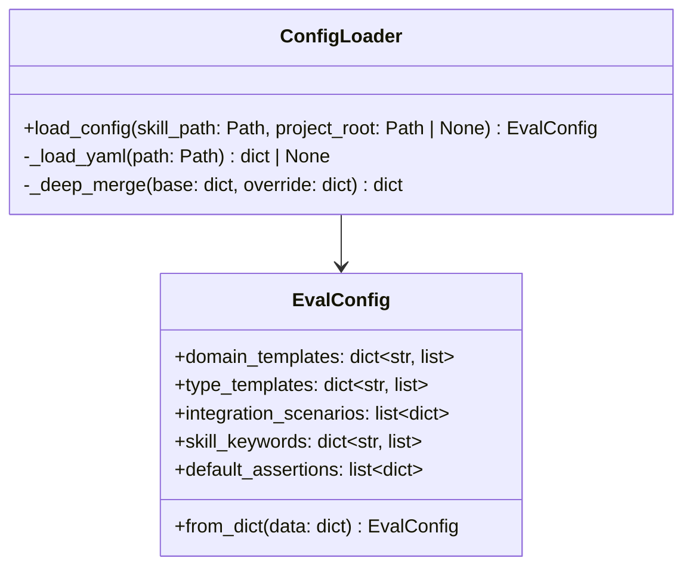

#### 5.1.3 三层合并逻辑

```python
def load_config(skill_path: Path, project_root: Path | None = None) -> EvalConfig:
    """
    三层配置加载：
    1. config/defaults.yaml — 框架内置默认值
    2. <project_root>/eval-config.yaml — 项目级配置
    3. <skill_path>/eval-config.yaml — skill 级配置（可选）

    后层覆盖前层，使用深度合并（dict 递归合并，list 替换）。
    """
```

#### 5.1.4 EvalConfig 模型

```python
class EvalConfig(BaseModel):
    domain_templates: dict[str, list[dict]] = {}
    type_templates: dict[str, list[dict]] = {}
    integration_scenarios: list[dict] = []
    skill_keywords: dict[str, list[str]] = {}
    default_assertions: list[dict] = []
```

#### 5.1.5 defaults.yaml

框架内置默认配置文件，位于 `src/skill_eval/config/defaults.yaml`。只包含通用默认值（如空断言列表），不包含任何领域特定内容。

### 5.2 LLM 配置生成 (`config/generator.py`)

#### 5.2.1 模块职责

扫描 Skill 集合元数据，通过 `claude -p` 自动生成 `eval-config.yaml`。

#### 5.2.2 类图

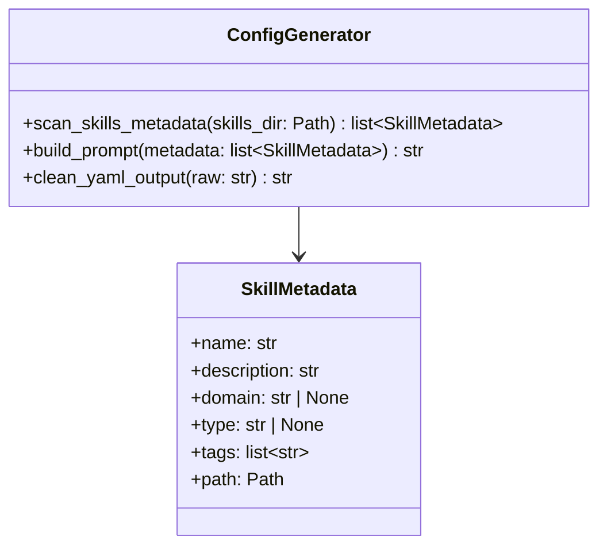

#### 5.2.3 scan_skills_metadata() 实现

```
1. 遍历 skills_dir 下所有含 SKILL.md 的子目录
2. 对每个 SKILL.md 调用 parse_skill_md() 获取 frontmatter
3. 提取 name, description, domain, type, tags
4. 返回 list[SkillMetadata]
```

#### 5.2.4 ConfigGenerator.build_prompt() 实现

构建包含以下内容的 prompt：
- 所有 Skill 的元数据（name + domain + type + tags + description）
- 9 种可用断言类型（FILE_EXISTS, CONTAINS_PATTERN, ..., CUSTOM_PLUGIN）
- 要求 LLM 输出 YAML 格式的 eval-config.yaml

#### 5.2.5 CLI 命令

```bash
skill-eval generate-config <skills_dir> --output eval-config.yaml
```

### 5.3 插件机制 (`scoring/plugins.py`)

#### 5.3.1 模块职责

注册和调度领域特定的 `CUSTOM_PLUGIN` 断言。

#### 5.3.2 类图

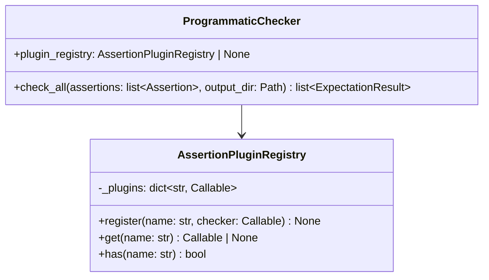

#### 5.3.3 插件注册

```python
registry = AssertionPluginRegistry()
registry.register("ARKTS_STRUCTURE_VALID", my_arkts_checker)
checker = ProgrammaticChecker(plugin_registry=registry)
```

插件函数签名：`def checker(params: dict, output_dir: Path) -> ExpectationResult`

当 `ProgrammaticChecker` 遇到 `CUSTOM_PLUGIN` 类型断言时，从 `plugin_registry` 查找 `params["plugin_name"]` 对应的函数调用。未注册的插件名返回 FAIL + `"Plugin 'xxx' not registered"`。

### 5.4 断言模板库 (`scoring/templates.py`)

#### 5.4.1 模块职责

从 `EvalConfig` 的 `domain_templates` 和 `type_templates` 读取模板，供 eval 生成使用。

#### 5.4.2 核心函数

```python
class AssertionTemplateLibrary:
    def __init__(self, config: EvalConfig | None = None): ...
    def get_domain_assertions(self, domain: str) -> list[Assertion]: ...
    def get_type_assertions(self, type_: str) -> list[Assertion]: ...
    def list_domains(self) -> list[str]: ...

def get_default_assertions(
    domain: str | None = None,
    type_: str | None = None,
    config: EvalConfig | None = None,
) -> list[Assertion]:
    """
    获取 domain + type 的合并断言列表（去重）。
    """
```

**去重逻辑**：按 `(name, type)` 二元组去重，domain 优先于 type。

### 5.5 L0 覆盖率扫描 (`scanning/scanner.py`)

#### 5.5.1 模块职责

扫描 evals.json 结构完整性和断言覆盖率，零 API 成本。

#### 5.5.2 核心函数

```python
def scan_evals(
    skills_dir: Path,
    config: EvalConfig | None = None,
    config_prefix: str | None = None,
    domain_filter: str | None = None,
    type_filter: str | None = None,
) -> list[SkillScanResult]:

def validate_evals_json(evals_path: Path) -> list[str]:

def check_assertion_coverage(evals_path: Path) -> AssertionCoverage:
```

#### 5.5.3 SkillScanResult 模型

```python
class SkillScanResult(BaseModel):
    skill_name: str
    skill_path: str
    has_evals: bool
    evals_path: str | None
    validation_errors: list[str]
    num_evals: int
    num_with_assertions: int
    assertion_coverage: float  # 0.0-1.0
    metadata: dict | None
```

#### 5.5.4 CLI 命令

```bash
skill-eval scan <skills_dir> [--config-prefix PREFIX] [--domain DOMAIN] [--type TYPE]
```

### 5.6 L2 集成测试 (`integration/runner.py`)

#### 5.6.1 模块职责

执行 Skill 间协作的集成测试，支持三种场景类型。

#### 5.6.2 三种场景类型

| 类型 | 说明 | 检查内容 |
|------|------|----------|
| `chain` | 链式传递 | 上游 Skill 的输出是否被下游 Skill 正确消费，失败是否传播 |
| `routing` | 关键词路由 | 根据 skill_keywords 配置，检查是否触发了正确的 Skill |
| `contract` | 制品验证 | 验证 Skill 间传递的制品是否符合契约 |

#### 5.6.3 核心函数

```python
def run_chain_test(
    skills: list[Path],
    steps: list[dict],
    output_dir: Path,
) -> ChainTestResult: ...

def run_routing_test(
    skills: list[Path],
    keywords: dict[str, list[str]],
    input_prompt: str,
    expected_skill: str,
    output_dir: Path,
) -> RoutingTestResult: ...

def run_contract_test(
    provider_skill: Path,
    consumer_skill: Path,
    artifact_path: str,
    output_dir: Path,
) -> ContractTestResult: ...

def run_integration_batch(
    scenarios: list[dict],
    skills_dir: Path,
    output_dir: Path,
) -> list[IntegrationTestResult]: ...
```

### 5.7 影响分析 (`integration/impact.py`)

#### 5.7.1 模块职责

分析新 Skill 的爆炸半径（影响范围），纯分析逻辑，不调用 LLM。

#### 5.7.2 核心函数

```python
class ImpactAnalyzer:
    def analyze(
        self,
        target_skill: str,
        all_skills: dict[str, list[str]],  # skill_name -> depends_on
        skill_keywords: dict[str, list[str]] | None = None,
    ) -> ImpactReport: ...

class ImpactReport(BaseModel):
    target_skill: str
    connections: list[str]      # 上下游关联的 skill
    risk_level: str             # low / medium / high
    affected_skills: list[str]  # 可能受影响的 skill
    routing_scenarios: list[str] # 涉及的路由场景
```

### 5.8 扩展的 AssertionType

v0.2 新增 3 种断言类型，加上原有 6 种，共 9 种内置断言类型：

| 类型 | 描述 | 参数 | 来源 |
|------|------|------|------|
| `CROSS_FILE_CONSISTENCY` | 检查相对 import 是否解析 | `include`(可选, glob) | 通用 |
| `CODE_COMPILES` | 基础语法检查（括号匹配） | `include`(可选, glob) | 通用 |
| `CUSTOM_PLUGIN` | 领域特定插件断言 | `plugin_name` + 插件自定义参数 | 扩展点 |

#### 5.8.1 CROSS_FILE_CONSISTENCY 实现

```python
def _check_cross_file_consistency(params: dict, output_dir: Path) -> ExpectationResult:
    """
    扫描 output_dir 下所有代码文件，检查相对 import 是否在目录中存在。
    支持 include 参数过滤文件类型。
    """
```

#### 5.8.2 CODE_COMPILES 实现

```python
def _check_code_compiles(params: dict, output_dir: Path) -> ExpectationResult:
    """
    扫描 output_dir 下所有代码文件，检查括号/花括号/方括号是否匹配。
    支持 include 参数过滤文件类型。
    """
```

#### 5.8.3 CUSTOM_PLUGIN 实现

```python
# 在 ProgrammaticChecker._check_single() 中：
elif assertion.type == AssertionType.CUSTOM_PLUGIN:
    plugin_name = assertion.params.get("plugin_name", "")
    if self.plugin_registry and self.plugin_registry.has(plugin_name):
        checker_fn = self.plugin_registry.get(plugin_name)
        return checker_fn(assertion.params, output_dir)
    else:
        return ExpectationResult(
            text=assertion.name,
            passed=False,
            evidence=f"Plugin '{plugin_name}' not registered",
            source="programmatic",
        )
```

### 5.9 EvalInitGenerator 增强

`EvalInitGenerator` 新增两个参数：

```python
class EvalInitGenerator:
    def __init__(self, config: EvalConfig | None = None, modes: list[str] | None = None): ...

    def generate_with_llm(self, skill_path: Path) -> EvalSet:
        """
        增强：
        - config 不为 None 时，从 domain_templates 自动注入领域断言
        - modes 不为 None 时，每个 mode 生成独立的 eval set
        """
```

`EvalCase` 模型新增 `mode` 字段：

```python
class EvalCase(BaseModel):
    ...
    mode: str = ""  # 所属 mode（如 create/refactor），空字符串表示通用
```

### 5.10 BatchScheduler 集成测试增强

```python
class BatchScheduler:
    def run_integration_tests(self, config: EvalConfig | None = None) -> list[IntegrationTestResult]:
        """
        从 EvalConfig.integration_scenarios 读取集成测试场景，
        调用 run_integration_batch() 执行。
        写入 integration-report.json。
        """
```

CLI 支持：`skill-eval batch manifest.json --layers integration`
